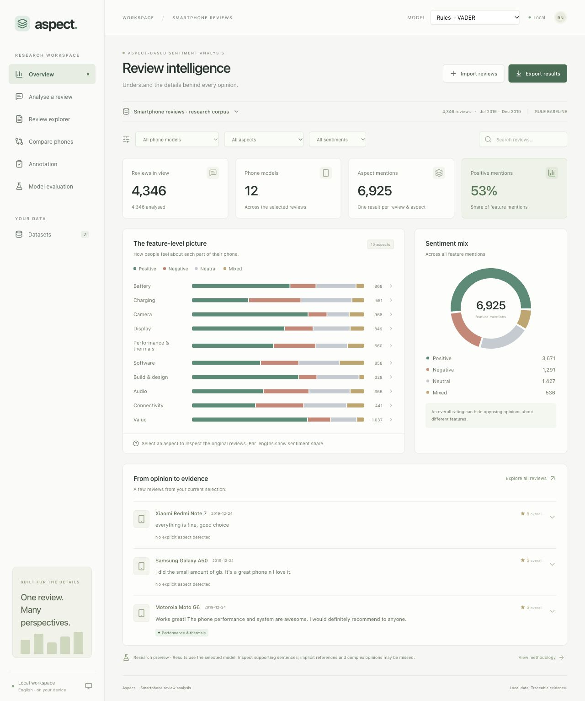
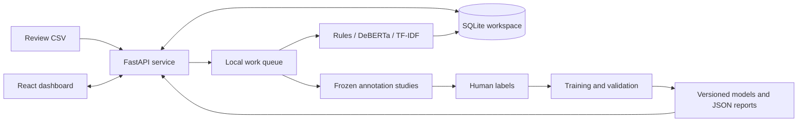
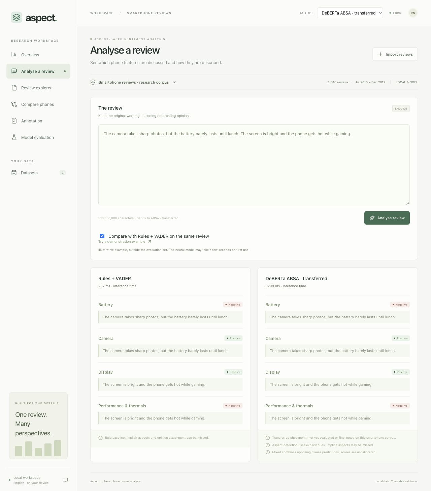
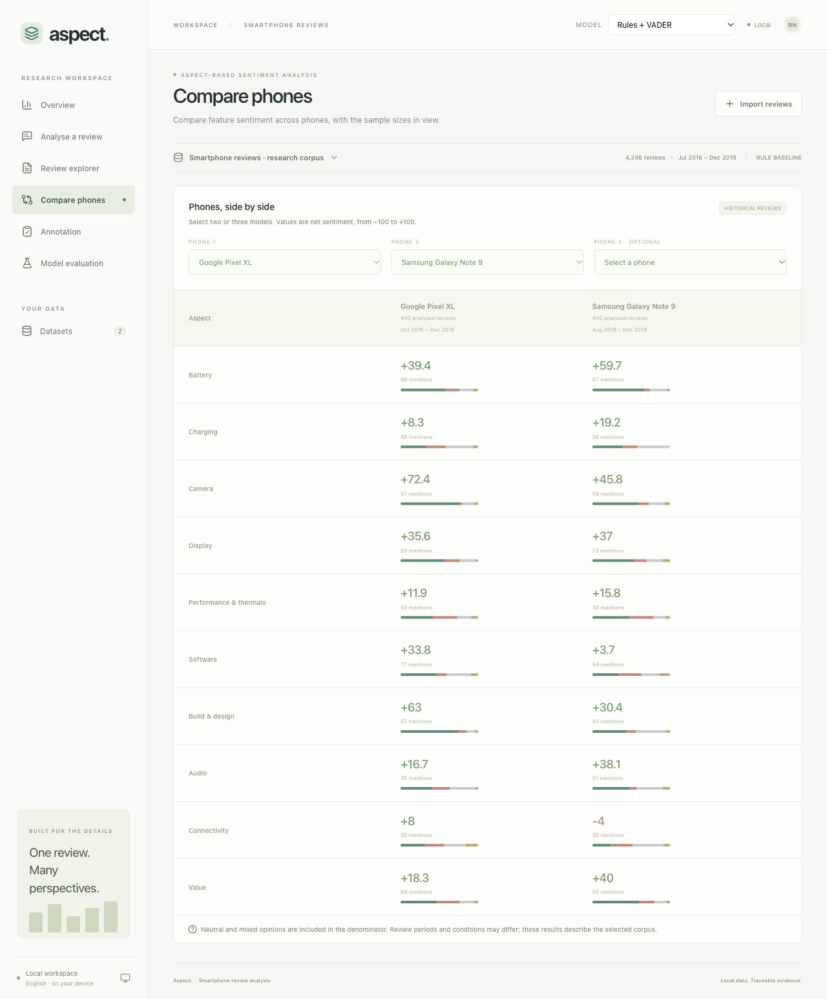
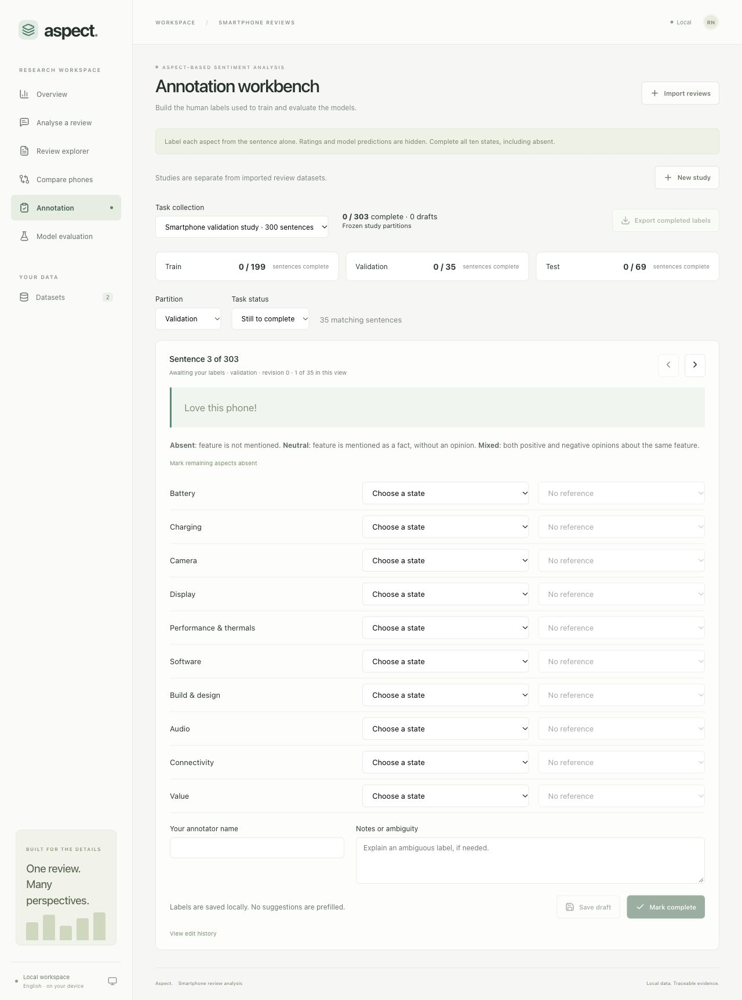
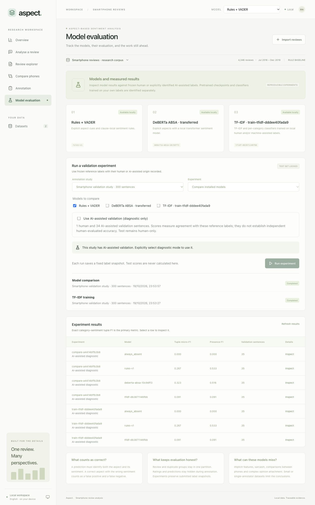

# Aspect — Smartphone Review Analysis

**Aspect-Based Sentiment Analysis of Smartphone Reviews**

A local research application that turns smartphone reviews into feature-level opinions, with the original sentences kept alongside each prediction. It combines data preparation, model inference, human annotation and reproducible evaluation in one dashboard.

[](https://github.com/raghavnimbalkar1/Aspect-Based-Sentiment-Analysis-of-Smartphone-Reviews/actions/workflows/checks.yml)




[Quick start](#quick-start) · [How it works](#how-it-works) · [Screenshots](#screenshots) · [Models](#models) · [Research workflow](#research-workflow) · [Documentation](#documentation)

## Why aspect-based analysis?

An overall rating cannot tell us which part of a phone someone liked. For example:

> The camera is excellent, but the battery is terrible.

| Aspect | Sentiment | Supporting evidence |
| --- | --- | --- |
| Camera | Positive | The original sentence |
| Battery | Negative | The original sentence |

The application tracks ten categories: **battery, charging, camera, display, performance and thermals, software, build and design, audio, connectivity, and value**. A mentioned aspect can be positive, negative, neutral or mixed. Annotation and supervised training also use an explicit **absent** state.

## Features

| Workspace | What you can do |
| --- | --- |
| **Overview** | Inspect aspect counts, sentiment distributions and the reviews behind each chart. |
| **Analyse a review** | Analyse English text and compare the selected model against the rule baseline on the same input. |
| **Review explorer** | Search original reviews, filter by phone/aspect/sentiment and inspect supporting sentences. |
| **Compare phones** | Compare two or three listings, with mention counts, review periods and low-support indicators. |
| **Annotation** | Create a frozen study, filter by partition/completion, label sentences without predictions or ratings, save drafts and export completed labels. |
| **Model evaluation** | Queue validation experiments, train TF-IDF classifiers, inspect scores, confusion matrices and individual errors, and download reports/predictions. |

CSV import supports column mapping and reports invalid rows and duplicates. Batch analysis preserves completed results and can resume unfinished records. Results, jobs and exports are separated by model and taxonomy version.

## Quick start

### Requirements

- Git, a POSIX shell and `make`.
- [uv](https://docs.astral.sh/uv/getting-started/installation/) for the Python environment. The repository selects Python 3.12.
- [Node.js](https://nodejs.org/) 24 or later; `.nvmrc` selects 24.
- Internet for initial dependency/data downloads. The installed application runs locally afterward.

The CPU inference path has been verified on an M2 MacBook Air with 8 GB RAM. A GPU and paid inference API are not required.

```sh
git clone https://github.com/raghavnimbalkar1/Aspect-Based-Sentiment-Analysis-of-Smartphone-Reviews.git
cd Aspect-Based-Sentiment-Analysis-of-Smartphone-Reviews

make setup
make data
make seed
make build
make run
```

Open **[http://localhost:8000](http://localhost:8000)**. The backend serves both the API and the built frontend. Stop it with `Ctrl+C`.

| Command | Purpose |
| --- | --- |
| `make setup` | Install locked Python and frontend dependencies. |
| `make data` | Download the fixed source version, verify checksums and prepare the selected smartphone corpus. |
| `make seed` | Import the prepared corpus idempotently and run the baseline. |
| `make build` | Build the React application. |
| `make run` | Start the saved workspace on port 8000 without downloading dependencies. |
| `make model-setup` | Install optional neural dependencies and download the pinned ABSA checkpoint. |
| `make check` | Run backend tests/lint, frontend formatting checks and the production build. |
| `make doctor` | Check the built dashboard, database, migrations and installed model integrity without changing labels. |

To start with your own CSV, skip `make data` and `make seed`, then choose **Import reviews**. After the initial setup, `bash scripts/start.sh` also starts the built application.

### Enable the neural model

```sh
make model-setup
make run
```

Choose **DeBERTa ABSA · transferred** in the model selector. The download contains approximately 706 MiB of weights/tokenizer files, in addition to the optional Python dependencies. Inference loads local files and uses CPU by default. Initial loading takes longer than subsequent requests. See [model setup and attribution](docs/MODELING.md).

## How it works

1. **Import and validate.** Preserve original review text, validate optional metadata, detect language and report rejected or repeated rows.
2. **Prepare evidence.** Split reviews into sentences while retaining their character offsets.
3. **Predict aspect sentiment.** Run the chosen analyzer and combine its sentence-level results into one result per review/category.
4. **Persist and inspect.** Save results in SQLite; use the same review selection for overview charts, the explorer and exports.
5. **Create human labels.** Sample complete reviews, group duplicates before partitioning and freeze task identities in a manifest.
6. **Evaluate reproducibly.** Compare models against completed human validation labels using an immutable input snapshot. Keep final test evaluation separate.



### Import your own reviews

Only a text column is required. Product, brand, date and overall rating are optional:

```csv
text,product,brand,date,rating
"The camera is sharp, but the battery drains quickly.",Phone A,Example,2026-01-15,3
"The display is bright and charging is fast.",Phone B,Example,2026-01-16,5
```

These rows are illustrative examples, not benchmark data. Map the columns in **Import reviews**, select a model and choose **Run analysis**. UTF-8 uploads are limited to 16 MB, 10,000 rows and 30,000 characters per review. Overall ratings remain metadata; they are never used as aspect labels.

Charts count each review/category once. Phone comparisons use:

```text
net sentiment = 100 × (positive mentions − negative mentions) / all present-state mentions
```

Neutral and mixed mentions remain in the denominator. The comparison screen covers the selected phones across the dataset; overview/explorer exports follow the active review filters.

## Screenshots

Screenshots below are captured from the running local application. Corpus views use the rule baseline. The neural comparison uses an illustrative input outside the evaluation set. The annotation and evaluation views show the actual unlabelled study; they do not display invented accuracy scores.

<details>
<summary><strong>Single-review analysis and model comparison</strong></summary>



</details>

<details>
<summary><strong>Phone comparison with sample sizes</strong></summary>



</details>

<details>
<summary><strong>Blind sentence annotation</strong></summary>



</details>

<details>
<summary><strong>Validation experiment workspace</strong></summary>



</details>

## Models

| Model | Method | Status |
| --- | --- | --- |
| **Rules + VADER** | Explicit feature cues, clause-local sentiment and documented domain heuristics. | Default baseline; all 4,346 corpus reviews processed. |
| **Transferred DeBERTa ABSA** | Explicit smartphone candidates paired with a pretrained three-state sentiment classifier. Opposing predictions are aggregated as mixed. | Local CPU inference verified; smartphone fine-tuning and independent benchmark results remain pending. |
| **TF-IDF + logistic classifiers** | Training-only word uni/bigrams and one five-state classifier per category. Single-class categories use a disclosed constant classifier. | Supports human or explicitly selected assisted training; independent human validation remains required. |

The neural checkpoint is **[`yangheng/deberta-v3-base-absa-v1.1`](https://huggingface.co/yangheng/deberta-v3-base-absa-v1.1)**, pinned to revision `10c9dff335a44073e1352360c3a7bc54dc58eb01`. Its published metadata declares MIT licensing. The downloader records file hashes, and inference uses local safetensors without executing repository-supplied Python code.

Our application adds the smartphone taxonomy, candidate pairing, evidence tracking, aggregation, persistence and research workflow. The transferred checkpoint is not presented as a model trained by this project. See [modeling decisions and limitations](docs/MODELING.md).

## Data

The source is Griko Nibras's [Amazon Cell Phones Reviews, version 2](https://www.kaggle.com/datasets/grikomsn/amazon-cell-phones-reviews/versions/2), whose dataset metadata declares CC0.

| Stage | Count |
| --- | ---: |
| Source review rows | 67,986 |
| Source product listings | 720 |
| Selected smartphone listings | 12 |
| Prepared corpus | 4,346 reviews |
| Detected English | 3,819 reviews |
| Short/undetermined language, retained provisionally | 527 reviews |

Preparation uses an explicit listing selection, preserves renewed/new condition, removes exact repeated listing/text rows and caps each listing at 400 reviews. The selected corpus spans July 2016–December 2019. It describes historical reviews and does not rank current phones.

Checksums and aggregate preparation evidence are committed under [docs/data](docs/data/README.md). Raw reviews, generated corpora, databases, labels and weights stay outside Git.

## Research workflow

1. Open **Annotation → New study** and choose an imported dataset. Use a training-only pilot to refine the annotation guide; use a full study for frozen train/validation/test partitions.
2. Label all ten category states for each sentence, including absent. Ratings and model predictions are hidden. Save drafts or mark reviewed decisions complete; edits retain their revision history.
3. Open **Model evaluation** after completing every validation sentence in the selected study. Choose installed-model comparison or TF-IDF training. Training accepts completed human training labels or an explicitly selected, separately prepared assisted training set.
4. Inspect tuple precision/recall/F1, presence F1, category support, the confusion matrix and individual errors. Download the JSON report and per-pair predictions to retain the evidence and source hashes.
5. Select the final model using validation. Final test evaluation requires the explicit CLI option described in [MODELING.md](docs/MODELING.md#human-evaluation-and-supervised-training).

The primary metric is **exact category–sentiment tuple micro-F1**. Detecting the correct aspect with the wrong sentiment counts as both a false positive and a false negative. An always-absent reference is included. Accuracy over predominantly absent categories is not used as the headline result.

A dashboard run freezes completed labels at submission and verifies their hashes before execution. It never evaluates test. Duplicate groups stay in one partition. Single-annotator labels must be reported as such; edit history does not establish inter-annotator agreement.

**Current research status:** a full study contains 199 training, 35 validation and 69 test sentences. A separate machine-generated training export covers the 199 training sentences; it does not fill the blind human tasks. Independent human annotation and measured smartphone accuracy remain pending. No project-trained TF-IDF model or smartphone fine-tuning result is claimed. Test fixtures are isolated and are not published as experiment results. See the [assisted training protocol](docs/ANNOTATION.md#assisted-training-for-the-solo-workflow).

## Technology and structure

| Layer | Technology |
| --- | --- |
| Interface | React, TypeScript, Vite, Recharts, Lucide |
| API and validation | Python, FastAPI, Pydantic |
| Persistence | SQLite, WAL journaling, numbered/checksum-checked migrations |
| Text processing | pysbd, langdetect, explicit feature expressions, VADER |
| Classical ML | scikit-learn, TF-IDF, logistic regression, joblib |
| Neural inference | PyTorch, Transformers, SentencePiece, safetensors |
| Verification | pytest, Ruff, Prettier, TypeScript, GitHub Actions |

```text
frontend/src/               Dashboard views, components and API types
src/smartphone_absa/
  api.py                   Review analysis and dataset routes
  annotation_api.py        Blind annotation routes
  research_api.py          Study creation, experiment runs and reports
  store.py, migrations/    SQLite persistence and schema upgrades
  baseline.py, models/     Model registry and inference adapters
  annotations.py           Sampling, duplicate grouping and frozen splits
  workbench.py             Label edits, conflicts, history and export
  research.py              Study preparation and immutable experiment inputs
  experiments.py           TF-IDF training and model comparisons
  assistance.py            Training-only generated labels and provenance
  predictions.py           Auditable per-pair predictions and error types
  diagnostics.py           Read-only readiness checks and latency measurement
  metrics.py               Exact tuple and presence metrics
  data.py, uploads.py      Verified corpus preparation and CSV validation
  cli.py                   Repeatable command-line workflows
config/products.json       Reviewed source-listing selection
docs/                      Research, guides, audit evidence and screenshots
tests/                     Isolated behavior, persistence and leakage checks
data/, artifacts/          Generated local files; ignored by Git
```

## Development and operations

```sh
make check
```

For separate development servers, run `make dev-api` and `make dev-ui` in two terminals, then open [localhost:5173](http://localhost:5173). The frontend proxies API requests to port 8000. Interactive API documentation is available at [localhost:8000/docs](http://localhost:8000/docs).

The default database is `data/workspace.sqlite3`; set `ABSA_DATABASE` and `ABSA_ARTIFACTS` to isolate another server workspace. Run one API process per database. Heavy background jobs share one local worker. Back up valuable labels before upgrades; introduce new numbered migrations instead of editing applied ones.

A model behavior change requires a new model ID before reprocessing data. Local TF-IDF IDs derive from their artifacts. Only load trusted local joblib artifacts. See [operations and backups](docs/OPERATIONS.md) and [contribution guidance](CONTRIBUTING.md).

CPU latency was measured on the M2 Air using 16 frozen source reviews and 48 warm requests per model. Warm median/p95 were **1.1/2.4 ms** for rules and **64.3/214.1 ms** for transferred DeBERTa. Neural initialization took 4.7 seconds, followed by a separate 2.3-second first inference. These are direct inference measurements, excluding HTTP/UI/database work; four sampled reviews had no explicit aspect cues. They measure responsiveness, not accuracy or concurrent capacity. The [method and full measurement record](docs/PERFORMANCE.md) describe the limits.

### Limits

- English is supported first. Short text can have uncertain language detection; Hindi/Hinglish remains a later extension.
- Explicit candidate detection can miss implicit features, sarcasm, cross-sentence references and difficult opinion attachment. Neural clauses over 512 tokens are rejected rather than silently truncated.
- Prediction scores are model-specific and uncalibrated. Sample sizes, historical coverage and renewed listings affect comparisons.
- This is a single-machine research workspace. It does not claim distributed processing, multi-user deployment or production-scale model accuracy.

## Documentation

- [Research plan and sources](RESEARCH_PLAN.md)
- [Application walkthrough and architecture](docs/APP_GUIDE.md)
- [Annotation protocol](docs/ANNOTATION.md)
- [Model setup, attribution and evaluation commands](docs/MODELING.md)
- [Data audit and preparation evidence](docs/data/README.md)
- [Delivery phases and verification record](docs/DELIVERY.md)
- [Local operations and database backups](docs/OPERATIONS.md)
- [Demo rehearsal and final evaluation checklist](docs/SUBMISSION.md)
- [CPU performance measurement](docs/PERFORMANCE.md)
- [Review of alternative labelled datasets](docs/BENCHMARK_DATA_REVIEW.md)

Dataset and pretrained-model licensing are documented with their sources above. Third-party libraries retain their own licenses; their use does not assign a license to this repository's original code.
