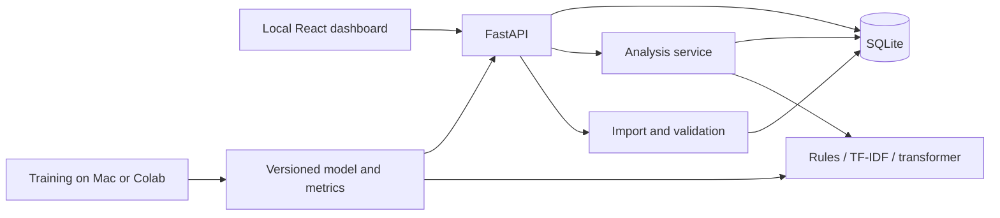

# Aspect-Based Sentiment Analysis of Smartphone Reviews

Research and implementation proposal · 19 October 2026 · Approved scope

**Status:** Scope approved on 19 October 2026. Implementation proceeds in phases; current progress and evidence are tracked in [docs/DELIVERY.md](docs/DELIVERY.md). Research findings below describe what was known before file-level verification and experiments.

## 1. The project we should build

Build a local application that turns smartphone reviews into evidence about individual features: camera, battery, display, performance, and so on. A user should be able to analyse a review, import a collection, inspect aspect-level results, compare phones, and see how the models were evaluated.

The academic contribution should be a carefully defined smartphone ABSA task, a small human-annotated dataset, a comparison of modeling approaches, and an analysis of where the system fails. The application should make those results useful and easy to demonstrate.

Our constraints are now clear:

| Item | Agreed constraint |
| --- | --- |
| Deadline | One week; exact submission time still to be confirmed |
| Team | Five members; you are responsible for implementation |
| Development machine | MacBook Air M2; RAM capacity not yet confirmed |
| Training | Colab GPU can be used when helpful |
| Final application | Local dashboard running on the Mac |
| Language | English first; Hindi/Hinglish later |
| Technology restrictions | None |

**Recommendation:** React and TypeScript for the interface, FastAPI for the backend, SQLite for saved data, and a compact transformer compared against simpler baselines. Training may happen on Colab, but the downloaded model, API, database, and dashboard should work locally without Colab during the demonstration.

A substantial seven-day project is possible if we keep one application, one main dataset, and one primary modeling approach. The scope below assumes one main developer. Help from other members is most valuable for annotation, verification, report preparation, and demo testing.

### What a correct result looks like

For this illustrative review:

> The camera takes sharp photos, but the battery barely lasts until lunch. The screen is bright and the phone gets hot while gaming.

The expected output is:

| Aspect | Sentiment | Supporting text |
| --- | --- | --- |
| Camera | Positive | “camera takes sharp photos” |
| Battery | Negative | “battery barely lasts until lunch” |
| Display | Positive | “screen is bright” |
| Performance and thermals | Negative | “gets hot while gaming” |

These are proposed annotations, not results from a model we have run. The first application version will show the full supporting sentence. Exact phrase extraction is a separate extension.

## 2. What the research tells us

ABSA covers several related tasks. Aspect category detection identifies a category such as battery; aspect term extraction identifies an actual text span such as “battery life”; sentiment classification assigns a polarity to that category or term. More ambitious tasks also extract opinion phrases and link them to aspects. These distinctions matter because each task needs different labels and evaluation. [Zhang et al., ABSA survey](https://arxiv.org/abs/2203.01054)

For this project, the primary task should be **aspect category detection with category-specific sentiment**, performed on sentences and aggregated to reviews and products. This is useful ABSA without making token-level extraction a prerequisite for the entire application.

### Papers and approaches that affect our decisions

| Work | Relevant finding or approach | Consequence for this project |
| --- | --- | --- |
| [SemEval-2014 Task 4 — Pontiki et al.](https://aclanthology.org/S14-2004/) | Established separate aspect and polarity tasks in laptop and restaurant reviews. Category annotations were provided for the restaurant domain. | Use its task definitions and evaluation ideas. Laptop data is useful background, but it does not directly supply our smartphone category labels. |
| [BERT with auxiliary sentences — Sun et al., 2019](https://aclanthology.org/N19-1035/) | Represents ABSA as classification of a text paired with an aspect description. | Use a sentence–category pair as the input to our main classifier. The model gets an explicit indication of which feature it is judging. |
| [MAMS — Jiang et al., 2019](https://aclanthology.org/D19-1654/) | Introduced examples with multiple aspects and different sentiments to expose shortcuts in easier datasets. | Include contrasting opinions in our evaluation. Whole-sentence sentiment copied to every aspect must be distinguishable from actual ABSA. |
| [SA2SL / UIT-ViSFD — Phan et al., 2021](https://arxiv.org/abs/2105.15079) | Connects a smartphone-specific annotated corpus to a social-listening application. The corpus is Vietnamese. | Supports the overall product direction and provides a useful annotation reference; it is not an English training dataset. |
| [iPhone 11 annotated dataset — Chehal, Gupta and Gulati](https://journals.riverpublishers.com/index.php/JWE/article/view/6205) | Studies manually annotated English phone reviews with category and sentiment classifiers. | Confirms a closely related problem setting. Its single-phone scope also shows why our evaluation should cover multiple products. |
| [SetFitABSA — official guide](https://huggingface.co/docs/setfit/main/how_to/absa) | Finds aspect candidates with spaCy, filters them, then classifies their polarity. Training uses explicit aspect spans. | A useful low-data alternative, especially for explicit aspects. Its candidate stage and annotation format do not directly solve our category-based implicit-aspect task. |
| [InstructABSA — Scaria et al., 2024](https://aclanthology.org/2024.naacl-short.63/) | Uses instruction tuning for several extraction and sentiment subtasks. | A credible later comparison if we expand to joint extraction. It adds more training and output-processing work than we need this week. |
| [Flexible ABSA evaluation — Yang et al., 2025](https://aclanthology.org/2025.naacl-long.603/) | Examines valid differences in extracted aspect and opinion spans that a single exact reference may penalise. | If we add phrase extraction, distinguish strict span accuracy from acceptable alternative wording. Do not quietly loosen the main metric. |
| [DABS — Xia et al., ACL 2026](https://aclanthology.org/2026.acl-long.667/) | Studies shared sentence encoding for efficient multi-aspect term sentiment classification. | Repeated encoding has a real cost. Start with the simpler pair model, measure latency, then consider shared encoding if it becomes a bottleneck. Its results concern ATSA, not our complete category-detection task. |

This is a focused review of work relevant to our decisions, including recent research. It is not a claim to have reproduced these papers or identified the best model across all ABSA benchmarks.

### Approaches considered

| Approach | Strength | Main limitation here | Decision |
| --- | --- | --- | --- |
| Aspect keywords plus sentiment lexicon | Fast, understandable, runs on CPU | Misses implicit aspects and can attach an opinion to the wrong feature | Required baseline |
| TF-IDF plus logistic regression | Inexpensive training and a meaningful supervised comparison | Limited handling of context and unfamiliar wording | Required baseline |
| BiLSTM/CNN with embeddings | Established neural comparison | Another training path without a clear seven-day advantage | Do not prioritise |
| Compact transformer conditioned on category | Can use context and distinguish the same sentence by target aspect | Needs trustworthy labels; inference repeats work across categories | Main candidate |
| SetFit / SetFitABSA | Worth testing when training data is scarce | Explicit span pipeline needs additional adaptation for our task | Fallback experiment if needed |
| PyABSA checkpoints | Existing ABSA tooling and extraction models | Checkpoint domains, label schemas, and training data need inspection | Optional external reference |
| Instruction-tuned or general-purpose LLM | Flexible structured extraction | Extra compute or API dependency, output validation, and reproducibility work | Later extension |

[VADER's repository](https://github.com/cjhutto/vaderSentiment) documents the lexicon and rule-based tool we can use in the first baseline. [PyABSA's repository](https://github.com/yangheng95/PyABSA) provides the candidate framework and checkpoints. Neither should be treated as a verified smartphone model before evaluation.

## 3. Dataset decision

The main data risk is confusing **review-level ratings** with **aspect-level labels**. A five-star review can contain a negative battery opinion. Star ratings may help us sample diverse reviews, but they cannot become the ground truth for every feature mentioned in them.

### Shortlist and verification status

| Source | What is available | Suitability | Access and limitations |
| --- | --- | --- | --- |
| [Griko Nibras: Amazon Cell Phones Reviews](https://www.kaggle.com/datasets/grikomsn/amazon-cell-phones-reviews) | Product and review CSVs; ten brands; a version collected in December 2019 | **Preferred raw source for this week** | Publisher's indexed card lists CC0 and about 25.6 MB for version 2. No aspect labels. Download, actual row counts, fields, and smartphone-only coverage still need checking. |
| [Amazon Reviews 2023, McAuley Lab](https://amazon-reviews-2023.github.io/main.html) | Reviews and product metadata; Cell Phones and Accessories category has about 20.8 million ratings | Strong future expansion source | Includes accessories and products missing metadata. Needs filtering and bounded loading. The reviewed pages did not settle redistribution terms. |
| [SemEval-2014 official data page](https://alt.qcri.org/semeval2014/task4/index.php?id=data-and-tools) | Labeled laptop and restaurant benchmark files | Secondary benchmark or transfer-learning experiment | Different domains and schemas. The official page separates material with different redistribution conditions; inspect the exact files' terms. |
| [Chehal et al. dataset paper](https://journals.riverpublishers.com/index.php/JWE/article/download/6205/10421/40099) | Reports 960 iPhone 11 reviews, 2,542 sentences before cleaning and 2,109 retained annotated sentences | Relevant English smartphone reference | A downloadable annotation file and its terms were not verified. Do not make the schedule depend on obtaining it. |
| [UIT-ViSFD, authors' repository](https://github.com/LuongPhan/UIT-ViSFD) | 11,122 comments, ten aspects, three polarities, published train/dev/test splits | Useful smartphone research reference | Vietnamese. Authors permit research use and ask commercial users to contact them. Translation would create a different dataset and evaluation problem. |

The Kaggle source is the practical first choice because the publisher describes a compact phone-focused collection. The accessible indexed card supplies the license and file information; the live page did not expose all details to the research browser. Those details must be checked against the downloaded version before we report final dataset statistics.

The Amazon 2023 documentation provides `parent_asin` for joining reviews to product metadata. If we use it later, phone filtering must happen through product metadata, not by treating the whole accessory category as smartphones. Its reviews extend through September 2023, so it would still be a historical corpus. [Amazon dataset documentation](https://amazon-reviews-2023.github.io/main.html)

App-store datasets such as [AWARE](https://zenodo.org/records/5528481) describe software applications, not handset hardware. The [smart-device dataset by Alghamdi and Alhasawi](https://pmc.ncbi.nlm.nih.gov/articles/PMC11637119/) spans several device types and is not a direct replacement for a smartphone-specific test set. These should not be selected merely because their titles mention mobile or smart devices.

### Proposed data volumes

These are planning targets, not existing assets or guarantees.

| Dataset layer | Target | Purpose |
| --- | --- | --- |
| First inspected sample | 100–200 reviews | Check smartphone relevance, columns, language, duplicates, and aspect coverage |
| Dashboard corpus | Initially 3,000–5,000 unique reviews from roughly 8–12 phone models | Enough real data for exploration and comparison without a large processing job |
| Annotation pilot | 100 sentences, from training-eligible reviews | Fix the category definitions and annotation instructions |
| Human-labeled corpus | Aim for 1,000–1,200 sentences; 600 is a reduced-scope fallback | Train and evaluate category–sentiment models |
| Locked test set | Aim for at least 200 sentences, grouped by original review | Final evaluation independent of model development |
| Challenge set | 40–60 separately labeled examples | Inspect negation, contrast, implicit aspects, and difficult wording |

The 100-sentence pilot may become part of training after re-annotation under the final rules. It must not enter the locked test set. Sentence counts will depend on how many complete source reviews are selected; the split procedure takes priority over hitting an exact number.

For annotation budgeting, assume approximately one to two minutes per sentence at first. One thousand sentences would then take about 17–33 person-hours before independent checking and dispute resolution. Measure the actual rate in the pilot. If teammates cannot help, reduce scope and report the smaller dataset honestly; do not replace independent evaluation with automatically generated labels.

### Preparation rules

1. Record the dataset version, source, terms, file checksum, and original columns.
2. Join reviews to products and identify actual smartphone models. Exclude cases, chargers, feature phones, and unrelated listings from the smartphone comparison corpus.
3. Map listing variants to a canonical phone model where the identity is clear. Preserve the original listing identifier and mark uncertain mappings.
4. Remove exact duplicates and inspect near-duplicates. Group repeated or closely paraphrased content before splitting.
5. Retain the original text. Normalise formatting in a separate field and preserve an offset mapping if text changes.
6. Keep negations, punctuation, and word order. Do not remove stopwords or stem the text fed to the transformer.
7. Record language, missing fields, excluded rows, and exclusion reasons. Include short valid reviews rather than imposing a blanket minimum length.
8. Keep stars and product metadata out of the primary text model's input. They remain available for filtering and dataset analysis.

The first release will analyse historical reviews from the selected source. Product comparisons describe that corpus; they are not claims about the best phones available today.

## 4. Aspect categories and annotation

Start with the following proposed categories. Freeze the definitions after the pilot. A category that has too few examples may be marked experimental or deferred before the final split is frozen.

| Category | Includes | Boundary to watch |
| --- | --- | --- |
| Battery | Endurance, drain, standby time | Charging speed belongs to Charging |
| Charging | Charging speed, port reliability, wireless charging | A standalone charger review is outside the corpus |
| Camera | Photos, video, selfies, focus, low-light results | Displaying a photo is not necessarily a camera opinion |
| Display | Brightness, colours, resolution, touch response | Cracked housing belongs to Build and design |
| Performance and thermals | Speed, lag, multitasking, gaming, heat | An app crash after an update may also concern Software |
| Software | OS, updates, interface, bloatware, software bugs | Generic slowness alone stays under Performance |
| Build and design | Materials, durability, weight, size, ergonomics | Shipping damage is recorded as a retail issue |
| Audio | Speaker, microphone, call sound, headphone output | Dropped calls concern Connectivity |
| Connectivity | Cellular signal, Wi-Fi, Bluetooth, GPS, dropped connections | Sound quality alone belongs to Audio |
| Value | Price satisfaction, affordability, value for money | A bare price statement is neutral, not automatically negative |

These boundaries are our proposed annotation policy. They are not copied as an established universal smartphone taxonomy.

### Labels

For each sentence and each category, assign one of five states:

| State | Meaning | Illustrative example |
| --- | --- | --- |
| Absent | This category is not discussed | Camera is absent in “It charges very quickly.” |
| Positive | A favourable opinion about that category | “The screen is easy to read outside.” |
| Negative | An unfavourable opinion about that category | “The battery is dead by noon.” |
| Neutral | The category is discussed without a clear favourable or unfavourable judgment | “It has a USB-C charging port.” |
| Mixed | Both favourable and unfavourable opinions about the same category occur in the sentence | “Daylight photos look good, but night shots are awful.” |

Mixed sentiment is not the same as uncertain prediction. A model can be uncertain about a clearly positive sentence. Likewise, an absent category is not neutral.

Annotators also record explicit versus implicit reference, the supporting sentence, optional aspect spans, and a short ambiguity note. “I keep looking for a socket by lunchtime” may implicitly concern battery endurance even without the word “battery.” General praise such as “Great phone” should remain a general opinion rather than being copied to every category.

Multiple categories may be present in a sentence. Positive camera and negative battery opinions do not make either category mixed. Mixed applies within a category. If positive and negative evidence appears in separate sentences of one review, the review-level aggregate becomes mixed while the sentence labels remain unchanged.

Shipping, seller service, and returns should be recorded as retail-related content, outside the phone-feature scores. We will not add a second retail sentiment model in week one. Reviews mentioning several phones need a target-ambiguity flag; product-level entity resolution is a later task.

### Annotation procedure

1. Have two people independently annotate the same 100-sentence pilot, with star ratings hidden.
2. Discuss disagreements and write concrete rules for recurring cases. Keep both original judgments and the adjudicated label.
3. Freeze taxonomy version 1, then annotate the remaining material.
4. Independently double-label at least 20% of the corpus. Prioritise independent checking of the locked test set, ideally all of it.
5. Report category-presence agreement and sentiment agreement separately. Use per-category agreement statistics and disagreement counts; a single accuracy number can be inflated by absent categories.
6. Treat unresolved cases explicitly. Record exclusions and include their count in the dataset report.

We can use [Label Studio's text-labeling facilities](https://labelstud.io/templates/sentiment_analysis) with a customised category/sentiment setup, or a constrained annotation sheet if setup takes too long. The labeling tool is an internal aid, not another application we need to build.

Do not prefill the test set with the model's predictions. Training-label assistance can be explored later, with the assistance recorded. Human corrections collected through the application enter a review queue; they do not automatically become ground truth or update the deployed model.

## 5. Modeling plan

### Main formulation

For each sentence, evaluate each of the ten categories using the pair:

`(sentence text, category description) → absent / positive / negative / neutral / mixed`

For example, the same sentence is evaluated once with “camera quality” and once with “battery endurance.” These can receive different labels. All categories are considered, so a keyword dictionary does not prevent detection of implicit aspects.

This is our adaptation of aspect-conditioned classification. It should not be described as a new architecture or an exact reproduction of the BERT-pair paper.

### Experiments to run

| ID | Model | Implementation intent | Role |
| --- | --- | --- | --- |
| B0 | Always absent / training-set majority | Fixed sanity-check predictions | Expose misleading accuracy under imbalance |
| B1 | Category dictionary + VADER | Match category cues, score local clauses, combine opposing evidence as mixed | Explainable rule baseline |
| B2 | TF-IDF + logistic regression | Shared text features with a separate five-state classifier for each category | Main classical baseline |
| M1 | DistilBERT pair classifier | Fine-tune one model across sentence–category pairs | Main transformer candidate |
| M2 | DeBERTa-v3-small or adapted SetFit | Only if M1 and the local application are already working | Optional comparison |

B2 should use category-specific classifiers or explicit feature interactions. Simply appending a category word to a shared bag-of-words classifier does not reliably model how that category changes the interpretation of the rest of the sentence.

The [DistilBERT model card](https://huggingface.co/distilbert/distilbert-base-uncased) lists an English pretrained model under Apache 2.0. It is a starting checkpoint, not an ABSA model. [DeBERTa-v3-small](https://huggingface.co/microsoft/deberta-v3-small) is another candidate, but “small” should not be read as cheaper than every alternative: its card lists substantial embedding parameters in addition to the backbone. We choose based on measured validation results, memory, and latency.

### Training controls

- Expand sentence–category pairs only after assigning source reviews to splits.
- Compute class weights and sampling rules from training data only. Absent pairs will probably dominate.
- Start with a small experiment budget: one initial configuration and at most two validation-driven adjustments. Investigate label errors before adding models.
- Use early stopping and save the selected checkpoint, tokenizer, category definitions, label mapping, seed, and configuration together.
- Aim for three runs of the selected configuration if time permits. Otherwise state clearly that the result is from one seed.
- Keep an eye on the mixed class. Retain its honest evaluation even if rare; do not merge it into neutral to improve the headline score.
- Measure token lengths before choosing a maximum. Handle long sentences with an explicit windowing or rejection policy and show truncation/coverage status. Never silently discard the part containing an aspect.

The [Transformers classification guide](https://huggingface.co/docs/transformers/tasks/sequence_classification) provides the standard fine-tuning machinery. Dependency versions and checkpoint revisions should be locked when implementation begins.

### Inference and aggregation

Sentence segmentation feeds the classifier. Each returned category includes its sentiment, source sentence, model version, and model score. A five-state softmax also allows category-presence probability to be calculated as `1 − P(absent)`.

The main benchmark uses unfiltered predictions. An optional “needs review” policy can apply validation-selected thresholds to the application, but it must report coverage and must not quietly remove difficult examples from the benchmark.

Expanding 1,000 sentences across ten categories creates 10,000 model inputs, but it still represents only 1,000 labeled sentences. Report both counts so the dataset size is not overstated.

At review level, combine accepted sentence labels for each category:

- Positive and negative evidence, or any mixed sentence → mixed.
- Positive evidence with only neutral evidence beside it → positive.
- Negative evidence with only neutral evidence beside it → negative.
- Only neutral evidence → neutral.
- No accepted evidence → no supported result; distinguish this from a confidently absent category when predictions were withheld.

This aggregation rule is a product decision to be documented and tested. It is not an additional learned model.

## 6. Evaluation we can defend

### Split policy

Use an approximately 60/20/20 train/validation/test split, subject to complete-review grouping and label support. All sentences from a review, all category pairs from a sentence, and duplicate clusters must remain in one partition.

The main test should reflect the intended corpus distribution. Rare-aspect enrichment can help the training set, but it must not silently turn the main test into an artificially balanced benchmark. Report the sampling method and per-label counts. Group-aware splitting is supported by the [scikit-learn cross-validation tools](https://scikit-learn.org/stable/modules/cross_validation.html).

Use validation data for model selection and thresholds. Freeze the test IDs before model development and evaluate the final selected setup once for the report. If we subsequently tune on those test errors, the set is no longer an untouched test.

Constructed challenge examples are useful diagnostics, but keep them separate from naturally occurring held-out reviews. Record who created them and the phenomenon each example tests. They must not inflate the main test score.

A separate phone-model holdout is a useful extension if enough labeled products exist. That tests transfer to unseen products. A random review-group split within known products does not justify an unseen-phone generalisation claim. Keep the two experiments separate.

### Metrics

| Question | Metric | Reporting requirement |
| --- | --- | --- |
| Did we find the discussed categories? | Presence precision, recall, micro-F1 and macro-F1 | Treat all four sentiment states as present; include per-category support |
| Did we get category and sentiment correct together? | **End-to-end category–sentiment tuple micro-F1** | Primary metric; tuples are `(sentence ID, category, sentiment)` and exclude absent |
| Which categories fail? | Tuple F1 per category and its macro-average | Declare how zero-support categories are handled |
| How good is sentiment when the category is known? | Sentiment macro-F1 on gold-present categories | Diagnostic only; choose among present-state logits for every gold category, even if the full model predicted absent |
| Are rare labels being ignored? | Per-class F1 and confusion matrices | Include neutral and mixed, plus class counts |
| Does it handle actual ABSA difficulty? | Scores on contrast, implicit-aspect, negation, and mixed subsets | Keep small-subset results descriptive |
| Is it usable locally? | Warm and cold latency, p50/p95, batch throughput, memory | Record Mac configuration, input sizes, batch size, and CPU/MPS device |

For tuple evaluation, a correct category with the wrong sentiment counts as a false positive for the predicted tuple and a false negative for the gold tuple. A missed category counts as a false negative. This prevents a good sentiment classifier from hiding poor aspect detection.

If phrase extraction is later added, report exact span F1 separately. Showing a supporting sentence does not establish that the model learned to extract the highlighted opinion phrase.

### Research questions

1. Does conditioning on the category improve end-to-end ABSA over rules and TF-IDF?
2. Where does the improvement occur: explicit aspects, implicit aspects, contrast, or negation?
3. Does additional human-labeled training data help enough to justify the annotation time?
4. What accuracy–latency tradeoff do we get when the selected model runs on the M2 Mac?

A small training-size experiment, such as 25%, 50%, and 100% of the training set, is more useful than adding several unrelated classifiers. Keep validation and test sets identical across those runs. Treat it as an extension if time is tight.

### Targets and limits

The intended outcome is a measured improvement over the strongest simple baseline, with errors documented. No accuracy or F1 is promised before seeing the data. If M1 loses, investigate and report that result rather than selecting it merely because it is a transformer.

With only a few hundred test sentences, rare-category and mixed-class estimates will be noisy. Show support beside every result. If uncertainty intervals are added, bootstrap by review rather than treating category pairs as independent observations.

Raw model scores should be labeled as scores. They are not a verified probability of correctness. Calibration is a later improvement unless the validation set is large enough to support a separate calibration portion. [Scikit-learn calibration documentation](https://scikit-learn.org/stable/modules/calibration.html)

## 7. Application scope

The interface should feel like one coherent review-analysis workspace. The initial navigation can have Overview, Analyse, Reviews, Compare, and Evaluation, with dataset management available from the workspace header.

| Feature | What the user can do | Priority | Completion criterion |
| --- | --- | --- | --- |
| Dataset import | Upload CSV, map required columns, preview rows | Essential | Invalid rows are counted and explained; valid rows persist |
| Single-review analysis | Paste text and inspect category-specific sentiment | Essential | Real model output with source sentences and clear unsupported-input states |
| Aspect overview | View mention counts and sentiment distributions | Essential | Every chart agrees with the underlying filtered records |
| Review explorer | Filter by model, category, sentiment, and keyword | Essential | Clicking a chart opens the matching reviews |
| Saved workspace | Reopen imported data and analysis results | Essential | Results survive an application restart |
| Batch analysis | Process an imported dataset with progress | Essential | Jobs show completed/failed counts and preserve completed chunks |
| Model evaluation page | Compare baseline and transformer results | Essential | Reads actual experiment artifacts and displays dataset/split/model versions |
| Phone comparison | Compare two or three models on selected aspects | Target for this week | Shows review counts, date coverage, and low-sample warnings |
| Result export | Download filtered predictions and summary data | Essential | CSV/JSON output matches the interface filters |
| Correction queue | Propose a corrected category or sentiment | Optional this week | Keeps original prediction and proposed correction separately |
| Date trends | Inspect aspect sentiment over time | Optional this week | Enabled only with reliable dates and sufficient volume |
| Print-friendly report | Save a compact analysis report | Optional this week | Includes filters, sample sizes, model version, and limitations |

The evaluation page is a viewer for completed experiments. Training jobs, hyperparameter editors, model registries, and experiment scheduling do not need to become dashboard features this week.

### Dashboard calculations

Count at most one result per review and category in the main charts. Otherwise, one long review could outweigh several short reviews. Sentence-level counts may be available in detail views, clearly identified.

For a category, let `N = positive + negative + neutral + mixed` among accepted review-level results. Report each state as a share of `N`, together with `N` itself. A compact net-sentiment indicator may be `100 × (positive − negative) / N`, but it must appear alongside neutral and mixed shares; both can produce a similar net score for very different reasons. Show no score when `N = 0`.

Mention rate uses the number of eligible analysed reviews as its denominator. Withheld predictions and incomplete jobs should be visible rather than counted as neutral or silently dropped. Default to a “limited evidence” label below a proposed 20 reviews mentioning a category; this is a display rule, not a guarantee that 20 is statistically sufficient.

Phone comparison should use the same filters and date range where possible. Do not combine these historical review scores into an unsupported overall “best phone” recommendation.

### Interface direction

Use a restrained layout, readable tables, clear sentiment colours with text labels, and charts that lead back to evidence. Useful views include stacked aspect bars, an aspect-by-phone heatmap, and a side-by-side comparison table. Avoid decorative charts that do not answer a question about the reviews.

Use real dataset counts and predictions in the final demo. Curated examples can illustrate behaviour, but they must be identified as demonstration cases rather than a representative test set.

## 8. Proposed architecture

| Layer | Proposed choice | Reason |
| --- | --- | --- |
| Frontend | React, TypeScript, Vite | Appropriate for linked filters, tables, and several dashboard views |
| Styling and charts | CSS with reusable components; one chart library | Consistent presentation without a large UI dependency stack |
| Backend | FastAPI and Pydantic | Typed request/response validation and documented endpoints |
| Storage | SQLite | Local persistence with little setup |
| Data preparation | pandas and a sentence segmenter | CSV handling and text preparation |
| Baselines | scikit-learn and VADER | Reproducible classical models |
| Main model | PyTorch and Hugging Face Transformers | Training and local checkpoint inference |
| Verification | pytest for critical logic; browser checks for demo flows | Cover the errors that could invalidate results or break the demo |

Framework references: [React](https://react.dev/learn), [Vite](https://vite.dev/guide/), and [FastAPI](https://fastapi.tiangolo.com/). Exact versions will be selected and locked after compatibility checks, not assumed from documentation snippets.

Streamlit remains a fallback if frontend time becomes the main risk. The recommended interface is React because it fits the requested product presentation. A Streamlit application can still be local; Colab is a compute environment, not the defining feature of the final application.

### Local operation

During development, use separate frontend and backend processes. For the demo, aim to serve the built frontend from the local backend so one launcher opens the complete application. Bind locally and keep datasets and saved results on the machine.

Start with one inference worker and bounded batches. Store job state and completed chunks in SQLite. After a restart, unfinished work should be marked interrupted and safely restartable without duplicating predictions. Redis, Celery, Kubernetes, and distributed services would add unnecessary work at this scale.

Cache only with keys that include the input text, model version, and taxonomy/preprocessing version. A changed model must not reuse stale predictions. Load one selected transformer at a time to conserve memory.

### Data records

| Record | Essential fields |
| --- | --- |
| Dataset | ID, source, version, import time, checksum, original/accepted/rejected counts |
| Product | Source listing ID, canonical model, brand, variant, mapping status |
| Review | ID, dataset/product references, raw text, optional stars/date, language, duplicate group |
| Sentence | ID, review ID, text and original-text offsets |
| Annotation | Sentence, category, state, annotator, adjudication status, taxonomy version |
| Prediction | Sentence/review reference, category, state, scores, model version, review-needed flag |
| Analysis job | Dataset, model, status, processed/failed counts, start/end times |
| Experiment | Training/split hashes, configuration, metrics, runtime, checkpoint revision |

Source names and user handles do not need to appear in the dashboard. Retain only fields needed for reproducibility and analysis.

### API boundaries

Plan endpoints for dataset upload and preview, analysis submission and job status, paginated reviews, filtered aggregates, product comparison, evaluation artifacts, and exports. These are service boundaries to agree on during design; there is no need to finalise every URL in the research draft.

### Hardware and training

PyTorch provides an MPS backend for supported macOS systems. We should check the actual installed versions and model behaviour before relying on it. Keep CPU inference as a tested fallback. [PyTorch MPS documentation](https://docs.pytorch.org/docs/stable/notes/mps.html)

Use Colab if it makes fine-tuning easier, then export the checkpoint and tokenizer for local use. Save checkpoints frequently because free GPU availability and runtime duration are variable. The demonstration must not depend on an active Colab session. [Colab resource FAQ](https://research.google.com/colaboratory/faq.html)

Until the Mac's RAM is confirmed, assume a conservative memory budget. Avoid large generative models and keep corpus processing bounded. Benchmark a small batch first; training time and local latency are currently unknown.

## 9. Seven-day delivery plan

Use three short iterations with a working result at each review. Day numbers are relative to the agreed start; time spent revising this research uses part of the available week.

| Day | Main work | Reviewable result | Decision at the end |
| --- | --- | --- | --- |
| 1 | Finalise scope; inspect the preferred data; run annotation pilot; agree schema and evaluation policy | Data audit, category guide, labeled pilot, interface sketch | Is the dataset usable, and can the annotation volume be completed? |
| 2 | Create grouped splits; continue annotation; build B1/B2; implement import and first analysis path | Real reviews flow through a baseline into the local app | Freeze essential feature scope and resolve data blockers |
| 3 | Train M1; export checkpoint; connect local inference; add persistent jobs | Saved transformer runs on the Mac and produces inspectable results | Compare validation quality and check memory/latency |
| 4 | Finish overview, linked filters, review explorer, and exports | Complete essential dashboard backed by real data | Cut optional screens if the main flow is still unstable |
| 5 | Add phone comparison if feasible; finish baseline comparison and diagnostic analysis | Near-final app and validation-based model selection | Freeze model configuration and feature additions |
| 6 | Run final held-out evaluation; verify aggregates, uploads, restart behaviour, and offline launch | Tested release candidate, final metric artifacts, error examples | Fix defects only; document limitations |
| 7 | Prepare setup instructions, report material, screenshots, and demo rehearsal | Reproducible local submission and backup demo recording | Confirm the app works from a clean restart without internet |

### Agile routine

Maintain a short backlog with To do, In progress, Review, and Done. Each item needs an observable completion condition. Keep no more than two active development tasks. At each daily review, demonstrate what works, record the main failure, and select the next day's work based on that evidence.

The three iteration outcomes are: data plus a baseline application by Day 2; transformer plus usable analytics by Day 4; a tested submission by Day 7. Features can be added when an iteration is stable, but the test-set policy and annotation definitions should not drift with UI changes.

### How the five members can contribute

This is a proposed allocation of support, not an assumption that all five will code.

| Responsibility | Useful contribution |
| --- | --- |
| You: implementation lead | Pipeline, model training, API, dashboard integration |
| Data support | Inspect source records, canonicalise products, annotate assigned material |
| Annotation and verification | Independently label overlap/test material and adjudicate disagreements |
| Research and evaluation support | Maintain references, verify result tables, organise error analysis |
| QA and presentation support | Test demo flows, prepare diagrams/report sections, rehearse explanation |

Members can share annotation work. If only you are available, the reduced plan should keep import, analysis, overview, explorer, exports, and honest baseline evaluation. Cut optional screens and experiments first. A polished application does not compensate for an invalid test set.

## 10. Backlog after the first release

| Extension | Why it is useful | Prerequisite |
| --- | --- | --- |
| Hindi/Hinglish support | Fits Indian smartphone-review usage | Real labeled mixed-language examples and separate language-specific evaluation |
| Aspect and opinion span extraction | More precise evidence and richer analysis | Span annotations, token alignment, extraction metrics |
| Adjacent-sentence context | Helps with references such as “The camera is new. It is much better.” | Clear target-sentence annotation and a context-aware experiment |
| Active-learning queue | Directs annotation toward informative examples | Reliable baseline, curated training pool, untouched test data |
| Shared-encoder model | Potentially reduces repeated category-pair inference | Profiling showing that model inference is the bottleneck |
| Complaint clustering | Groups recurring issues within a category | Stable predictions and manually checked cluster descriptions |
| Evidence-linked summaries | Gives a short account of common strengths and complaints | Retrieval of supporting reviews and checks against unsupported statements |
| Newer review sources | Makes analysis relevant to newer devices | Verified access, provenance, terms, and product mapping |
| Generalisation study | Tests transfer across brands or sources | Enough independently labeled held-out products/sources |

Hindi/Hinglish should not be presented as solved by silently translating every input. Translation can change sentiment and would need its own evaluation. Until support exists, the application should explain that English is the supported language and handle uncertain language detection sensibly.

Do not add login systems, a chatbot, live retailer scraping, mobile apps, or fake-review detection to the first-week commitment. They introduce separate problems without strengthening the core ABSA evidence.

## 11. Main risks and planned responses

| Risk | Early signal | Response |
| --- | --- | --- |
| Dataset download or schema differs from expectations | Day 1 audit cannot reproduce the publisher's description | Inspect an alternative documented source; keep source selection open until files are checked |
| Too few useful labels | Pilot annotation is slow or categories rarely appear | Reduce supported scope before freezing the dataset; recruit annotation help; show low-support results |
| Model memorises duplicates | Similar sentences appear across proposed splits | Group duplicates before pair expansion and rerun split checks |
| Strong overall accuracy but poor ABSA | Most predictions are absent or all aspects share one sentiment | Use tuple F1 and contrast subsets; inspect category-specific errors |
| Mixed/neutral labels are inconsistent | Frequent annotator disagreement | Tighten examples and adjudicate; report class support and limits |
| M1 does not beat B2 | Validation performance is similar or worse | Check data and training setup; choose the better supported model and report the comparison |
| MPS or memory problems | Model fails or becomes slow under small batches | Use CPU inference or smaller batches; train on Colab if available |
| Dashboard work consumes the week | Day 4 essential workflow is incomplete | Stop optional features; keep one stable analysis workflow |
| Phone comparisons look more certain than the data allows | Small, uneven, or historical review samples | Display counts, dates, mixed opinions, and limited-evidence states |
| Demo depends on downloads or temporary sessions | Restart needs network access | Package cached model, sample data, frontend build, and launch instructions |

## 12. Definition of done

The first release is ready when:

- The application starts locally from documented instructions and reopens saved results.
- Single and batch analysis use actual models; no result cards are backed by placeholder predictions.
- The selected corpus has documented provenance, filtering, and counts.
- The labeled data has stable annotation rules and review-grouped splits.
- Rules, TF-IDF, and the transformer have been evaluated under the same primary task and split. Any omitted experiment is stated explicitly.
- The final report includes tuple F1, category-level results, support counts, latency, and representative errors.
- Dashboard counts and exports match, including mixed, neutral, withheld, and failed cases.
- Empty text, malformed CSVs, duplicate imports, long inputs, unsupported languages, and interrupted processing have defined behaviour.
- The demonstration works after a clean restart with the internet disconnected, once dependencies and artifacts are installed.
- The submission includes setup instructions, a model/data description, experiment configurations, references, and a clear statement of limitations.

Critical verification should cover split leakage, label mappings, sentence offsets, aggregation rules, cache invalidation, and upload validation. Browser checks should cover the complete import → analyse → filter → inspect → export workflow. There is no need to write a large test suite for cosmetic components.

## 13. Demo outline

1. Open the saved dataset and show its source, date coverage, and product counts.
2. Analyse a review containing opposing camera and battery opinions.
3. Show an implicit aspect and one known failure case.
4. Select an aspect in the overview and inspect the underlying reviews.
5. Compare two phones, keeping sample sizes visible.
6. Open the evaluation page and explain what changed from the classical baseline to the selected model.
7. Export the filtered results and show that the workspace persists after restart.

The explanation should make clear what we built, which pretrained components we reused, what we measured, and what remains unreliable. The combination of data work, modeling, evaluation, and a working local application gives the project its substance.

## 14. Decisions for the research review

Recommended defaults are listed here so we can revise the plan without reopening every detail:

| Decision | Proposed default | Current status |
| --- | --- | --- |
| Application | Local React + FastAPI + SQLite dashboard | Recommended; awaiting research review |
| Raw dataset | Griko Nibras phone reviews, version 2 | Recommended; file-level verification pending |
| Task | Sentence-level category and sentiment classification, then review aggregation | Recommended |
| Categories | Ten proposed categories, adjusted after pilot support checks | Provisional |
| Main model | Fine-tuned DistilBERT pair classifier | Candidate; selection depends on evaluation |
| Baselines | Rules + VADER, TF-IDF + logistic regression | Recommended |
| Annotation | About 1,000–1,200 sentences with independent checking | Depends on team availability and pilot speed |
| First-week scope | Essential dashboard features; phone comparison if core is stable | Recommended |
| Later scope | Hindi/Hinglish, precise spans, context, active learning | Deferred |

The remaining practical inputs are the exact submission date/time, the Mac's RAM, and whether other members can help with annotation and independent testing. They affect the size of the first release, not the overall direction.

The project now proceeds under this scope. Changes driven by the data audit, annotation pilot, or measured model behaviour should be recorded in the delivery notes.
