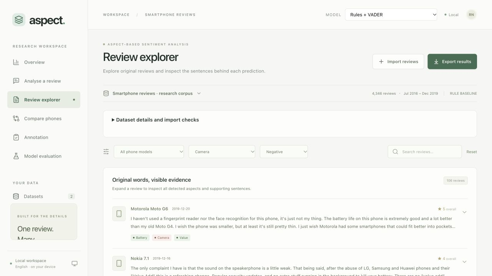
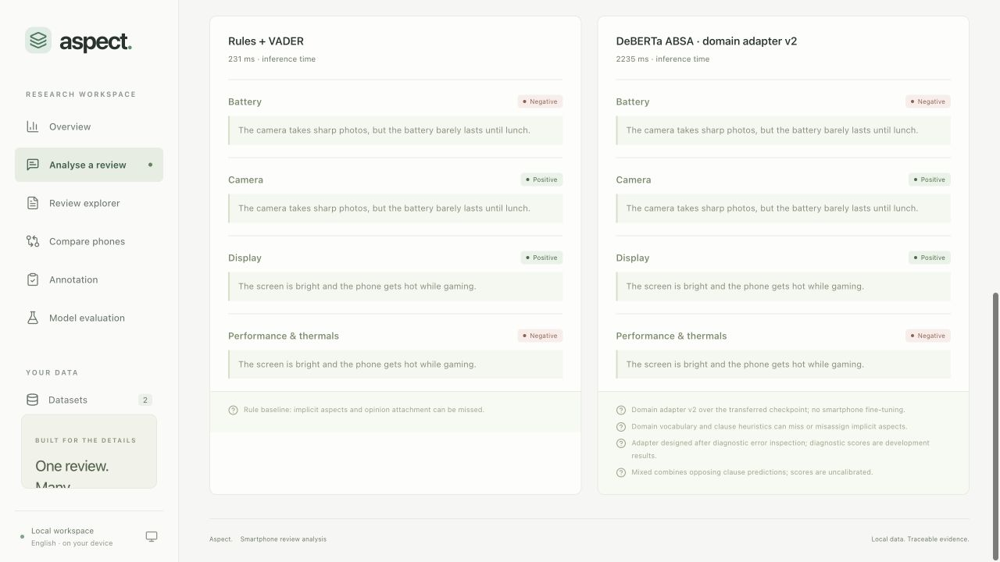
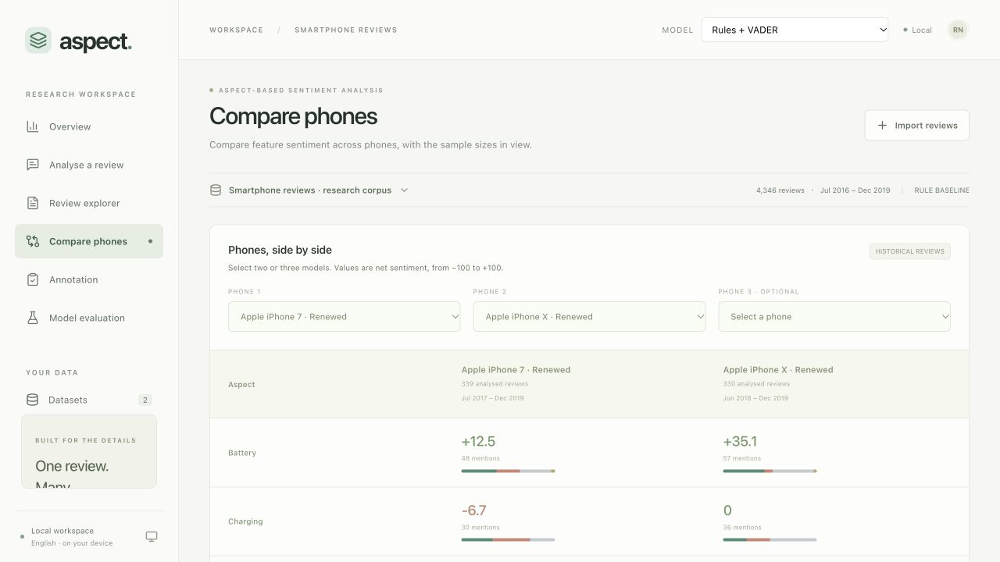
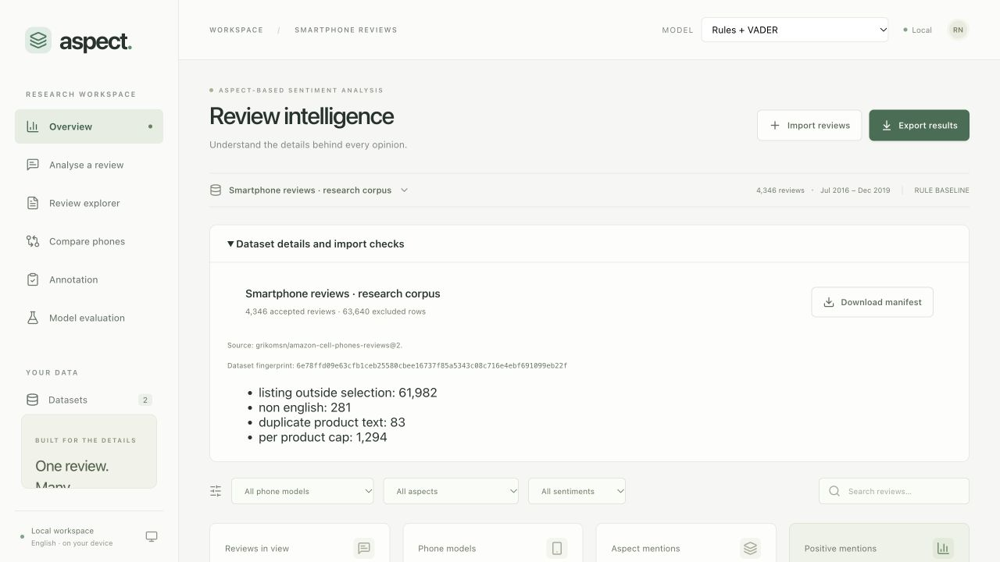
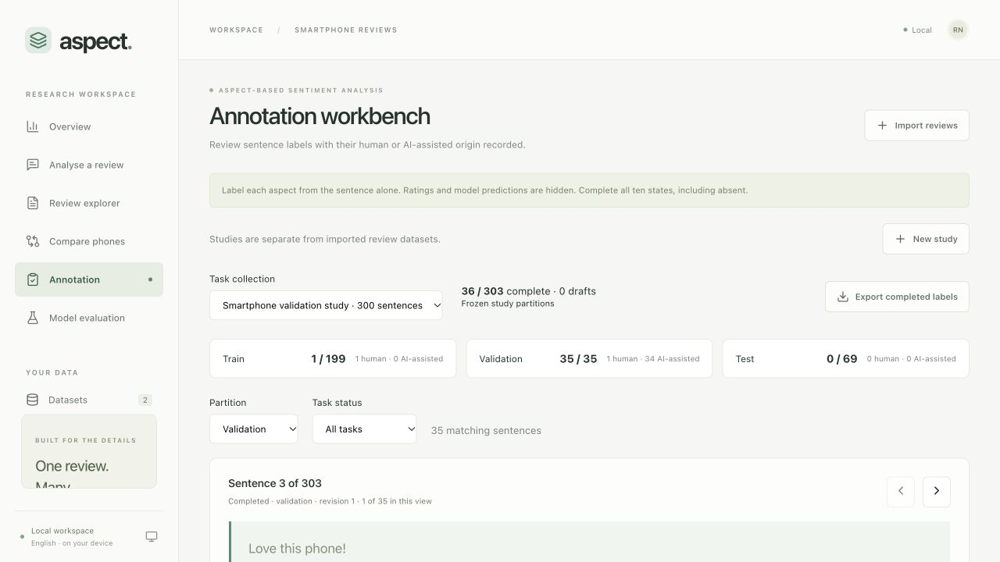
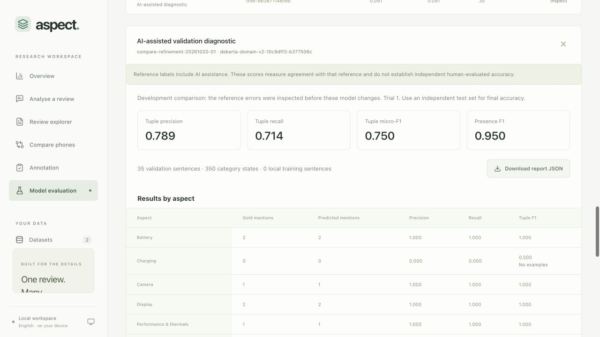
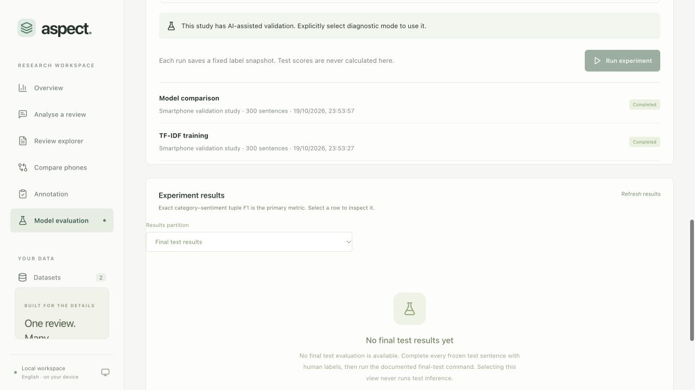

# Smartphone ABSA project reference guide

This is the reading companion to the 52-slide PowerPoint. It describes application release 1.0.0. The Notes text supplies implementation detail and source references. Independent human test accuracy remains pending.

## 01. Aspect-based sentiment analysis of smartphone reviews

*PROJECT REFERENCE*

### Explanation

This guide describes the actual version 1.0.0 implementation and its recorded results. It is written for individual study rather than a timed presentation. The software release is complete for the documented English workflows. Independent human test accuracy is still pending. Read the slide text for the main explanation and open PowerPoint Notes for definitions, implementation detail and source references. The project combines a local web application with a reproducible research workflow. It does not claim that the transferred checkpoint was trained by this project or that the development diagnostic establishes general smartphone accuracy.

### Sources

- https://github.com/raghavnimbalkar1/Aspect-Based-Sentiment-Analysis-of-Smartphone-Reviews/blob/8e4d312f208d021e9b5e729435197ecf21bbfb9a/README.md
- https://github.com/raghavnimbalkar1/Aspect-Based-Sentiment-Analysis-of-Smartphone-Reviews/blob/8e4d312f208d021e9b5e729435197ecf21bbfb9a/docs/QUALITY_ASSURANCE.md

## 02. How to use this guide

*READING MAP*

The main sequence explains the project. The appendix provides implementation references.

| Pages | Subject |
| --- | --- |
| 3–7 | Problem, outputs and sentiment categories |
| 8–14 | Source data, preparation and annotation provenance |
| 15–29 | Architecture, persistence and model implementation |
| 30–36 | The six application workspaces |
| 37–43 | Metrics, results, performance and verification |
| 44–48 | Operations, limitations and further reading |
| 49–52 | Listings, schemas, API and reproduction commands |

### Explanation

The slides follow the path a review takes through the system, then explain how the project measures its outputs. Technical terms receive a definition before they appear in the model comparison. Screenshots show the real application, while tables and charts retain editable text and data. The results chapter repeatedly identifies the reference origin because the 35 validation sentences are mostly AI-assisted and the revised adapter used their errors during development. The appendix is useful when reading the source code or repeating a command. All figures describe the recorded project snapshot, not current smartphone market conditions.

### Sources

- https://github.com/raghavnimbalkar1/Aspect-Based-Sentiment-Analysis-of-Smartphone-Reviews/blob/8e4d312f208d021e9b5e729435197ecf21bbfb9a/docs/APP_GUIDE.md
- https://github.com/raghavnimbalkar1/Aspect-Based-Sentiment-Analysis-of-Smartphone-Reviews/blob/8e4d312f208d021e9b5e729435197ecf21bbfb9a/docs/RESULTS.md

## 03. What the application does

*THE PROBLEM*

It converts review text into opinions about individual phone features.

**Input.** English reviews supplied as text or CSV. Product, date and overall rating are optional metadata.

**Output.** An aspect category, a sentiment state and the original sentence supporting the prediction.

The dashboard aggregates these predictions and lets the reader trace counts back to reviews.

### Explanation

An overall rating compresses several opinions into one number. A reviewer can like the camera and dislike the battery in the same review. The application preserves those separate opinions. It also stores each model’s results independently so comparisons remain traceable. The software supports importing data, processing a corpus, inspecting reviews, comparing phones, annotating sentences and evaluating models. Ratings never become aspect labels. General praise may produce no aspect result when the model cannot identify a category. This is a local research workspace running in a browser on the same computer as the backend and database.

### Sources

- https://github.com/raghavnimbalkar1/Aspect-Based-Sentiment-Analysis-of-Smartphone-Reviews/blob/8e4d312f208d021e9b5e729435197ecf21bbfb9a/README.md
- https://github.com/raghavnimbalkar1/Aspect-Based-Sentiment-Analysis-of-Smartphone-Reviews/blob/8e4d312f208d021e9b5e729435197ecf21bbfb9a/src/smartphone_absa/domain.py

## 04. One review can contain opposing opinions

*THE PROBLEM*

> The camera is excellent, but the battery is terrible.

| Category | Sentiment | Reason |
| --- | --- | --- |
| Camera | Positive | The review praises the camera. |
| Battery | Negative | The review criticises battery quality. |

### Explanation

This is an illustrative example written for explanation, outside the evaluation study. Aspect-based sentiment analysis requires identifying both the feature and the opinion attached to it. The conjunction creates two local opinion contexts. A sentence-level positive or negative label alone would lose this distinction. In the application, evidence points to the full original sentence even when the classifier uses a shorter clause internally. The saved start and end offsets make it possible to retrieve exactly the same evidence from the review text. An overall rating, if present, stays separate from these aspect predictions.

### Sources

- https://github.com/raghavnimbalkar1/Aspect-Based-Sentiment-Analysis-of-Smartphone-Reviews/blob/8e4d312f208d021e9b5e729435197ecf21bbfb9a/src/smartphone_absa/models/inference.py
- https://github.com/raghavnimbalkar1/Aspect-Based-Sentiment-Analysis-of-Smartphone-Reviews/blob/8e4d312f208d021e9b5e729435197ecf21bbfb9a/src/smartphone_absa/text.py

## 05. The first five aspect categories

*LABEL DEFINITIONS*

| Category | What belongs here | Typical cues |
| --- | --- | --- |
| Battery | Endurance, drain and standby time | battery, standby, lasts all day |
| Charging | Charging speed, ports and wireless charging | charger, USB-C, charging |
| Camera | Photo, video and camera quality | photos, selfies, video |
| Display | Screen brightness, colour and touch response | screen, AMOLED, resolution |
| Performance | Speed, gaming, lag and heat | lag, gaming, processor, speed |

### Explanation

The taxonomy defines ten fixed categories and uses the same identifiers in annotations, model outputs, SQLite records and metrics. Performance also covers thermal complaints. The table includes cues from both the original taxonomy and the revised domain adapter. A cue is a candidate detector, not a gold label or a guarantee that the sentence discusses the intended phone feature. For example, fast shipping should not become performance, and charging speed should not become phone processing speed. A taxonomy change would require a new version. The version used throughout the recorded experiments is smartphone-v1.

### Sources

- https://github.com/raghavnimbalkar1/Aspect-Based-Sentiment-Analysis-of-Smartphone-Reviews/blob/8e4d312f208d021e9b5e729435197ecf21bbfb9a/src/smartphone_absa/taxonomy.py
- https://github.com/raghavnimbalkar1/Aspect-Based-Sentiment-Analysis-of-Smartphone-Reviews/blob/8e4d312f208d021e9b5e729435197ecf21bbfb9a/src/smartphone_absa/models/aspects_v2.json

## 06. The other five aspect categories

*LABEL DEFINITIONS*

| Category | What belongs here | Typical cues |
| --- | --- | --- |
| Software | Operating system, interface, updates and bugs | Android, apps, Bixby, setup |
| Build and design | Materials, durability, size and ergonomics | frame, plastic, buttons, grip |
| Audio | Speakers, microphones and calls | speaker, microphone, volume |
| Connectivity | Cellular service, Wi-Fi, Bluetooth and GPS | signal, SIM, unlocked, carriers |
| Value | Affordability and satisfaction with price | price, worth, expensive, deal |

### Explanation

The scope of a category matters more than matching a word. A volume button belongs to physical controls, while speaker volume belongs to audio. Delivery, packaging and seller service do not automatically belong to any phone-feature category. The current taxonomy also has gaps, including biometric reliability as a distinct topic. The project preserves such ambiguities in annotation notes rather than silently creating new categories to improve a score. Value should describe price or purchase value, although the existing human validation label for general praise illustrates that annotation consistency still needs review in a future independent study.

### Sources

- https://github.com/raghavnimbalkar1/Aspect-Based-Sentiment-Analysis-of-Smartphone-Reviews/blob/8e4d312f208d021e9b5e729435197ecf21bbfb9a/src/smartphone_absa/taxonomy.py
- https://github.com/raghavnimbalkar1/Aspect-Based-Sentiment-Analysis-of-Smartphone-Reviews/blob/8e4d312f208d021e9b5e729435197ecf21bbfb9a/docs/ANNOTATION.md
- https://github.com/raghavnimbalkar1/Aspect-Based-Sentiment-Analysis-of-Smartphone-Reviews/blob/8e4d312f208d021e9b5e729435197ecf21bbfb9a/docs/RESULTS.md

## 07. Five states keep absence separate from neutrality

*LABEL DEFINITIONS*

| State | Meaning | Illustrative example |
| --- | --- | --- |
| Absent | The category is not mentioned. | “Great phone” does not name a battery aspect. |
| Positive | The text expresses a favourable opinion. | “The screen is excellent.” |
| Negative | The text expresses an unfavourable opinion. | “The camera is awful.” |
| Neutral | The category appears as a fact without an opinion. | “It has a USB-C charging port.” |
| Mixed | The same category has opposing opinions. | “Daylight photos are good, night shots are bad.” |

### Explanation

Absence and neutrality are different learning targets. An absent state means the feature did not receive relevant evidence. A neutral state means the review mentioned it without a positive or negative judgement. Annotation and classical training use all five states. The transferred checkpoint itself predicts only negative, neutral and positive. Its candidate gate produces absence, and aggregation produces mixed when opposing local predictions occur. The interface displays mentioned aspects while the evaluation includes an absent decision for every other category. This prevents a model from receiving credit merely because most categories are absent.

### Sources

- https://github.com/raghavnimbalkar1/Aspect-Based-Sentiment-Analysis-of-Smartphone-Reviews/blob/8e4d312f208d021e9b5e729435197ecf21bbfb9a/src/smartphone_absa/taxonomy.py
- https://github.com/raghavnimbalkar1/Aspect-Based-Sentiment-Analysis-of-Smartphone-Reviews/blob/8e4d312f208d021e9b5e729435197ecf21bbfb9a/src/smartphone_absa/models/inference.py
- https://github.com/raghavnimbalkar1/Aspect-Based-Sentiment-Analysis-of-Smartphone-Reviews/blob/8e4d312f208d021e9b5e729435197ecf21bbfb9a/src/smartphone_absa/metrics.py

## 08. The source contains reviews and product listings

*THE DATASET*

Griko Nibras, Amazon Cell Phones Reviews, fixed version 2. Source metadata declares CC0.

| Source file | Rows | Useful fields |
| --- | --- | --- |
| 20191226-items.csv | 720 listings | ASIN, brand, title, product links and listing metadata |
| 20191226-reviews.csv | 67,986 reviews | ASIN, body, rating, date, title and verification metadata |

The source spans 2003–2019 and includes feature phones and renewed listings. It has no ABSA gold labels.

### Explanation

The project downloads a fixed version rather than silently accepting whichever dataset version is current. SHA-256 checksums verify the two source files. ASIN is the join key connecting reviews to product listings. The source audit found no review rows with a missing product, 12 empty bodies and 1,095 repeated listing/body combinations after case and whitespace normalisation. Those are global raw-source counts. They differ from the 83 duplicate rows removed after the explicit smartphone selection. Ratings and reviewer metadata exist in the source but do not supply aspect annotations. Source date coverage also differs from the selected corpus date coverage.

### Sources

- https://www.kaggle.com/datasets/grikomsn/amazon-cell-phones-reviews/versions/2
- https://github.com/raghavnimbalkar1/Aspect-Based-Sentiment-Analysis-of-Smartphone-Reviews/blob/8e4d312f208d021e9b5e729435197ecf21bbfb9a/docs/data/source-audit.json
- https://github.com/raghavnimbalkar1/Aspect-Based-Sentiment-Analysis-of-Smartphone-Reviews/blob/8e4d312f208d021e9b5e729435197ecf21bbfb9a/scripts/download_data.py

## 09. A bounded smartphone corpus

*THE DATASET*

The application uses 12 explicitly selected listings rather than treating every source item as a smartphone.

**Selection.** Source titles identify the selected phone listings. Renewed iPhones remain separate from listings marked new.

**Sampling.** The preparation pipeline caps each listing at 400 reviews. Smaller listings keep their available eligible reviews.

The final corpus has 4,346 reviews dated July 2016 to December 2019.

### Explanation

The selection policy makes the demonstration manageable on a laptop and keeps product identity explicit. It is not a representative sample of all smartphone buyers or brands. Two renewed iPhone listings remain visibly identified as renewed. The cap limits domination by a few large listings, but it also changes the source distribution. Most selected listings reach 400 reviews. The renewed iPhone 7 and iPhone X retain 339 and 330 reviews, while OnePlus 6T retains 77. The appendix lists all identifiers and counts. These historical reviews cannot support recommendations about phones available today.

### Sources

- https://github.com/raghavnimbalkar1/Aspect-Based-Sentiment-Analysis-of-Smartphone-Reviews/blob/8e4d312f208d021e9b5e729435197ecf21bbfb9a/config/products.json
- https://github.com/raghavnimbalkar1/Aspect-Based-Sentiment-Analysis-of-Smartphone-Reviews/blob/8e4d312f208d021e9b5e729435197ecf21bbfb9a/src/smartphone_absa/data.py
- https://github.com/raghavnimbalkar1/Aspect-Based-Sentiment-Analysis-of-Smartphone-Reviews/blob/8e4d312f208d021e9b5e729435197ecf21bbfb9a/docs/data/README.md

## 10. Preparation accounts for every source row

*THE DATASET*

| Step | Rows excluded at this step | Rows remaining |
| --- | --- | --- |
| Original review source | 0 | 67,986 |
| Outside the 12-listing selection | 61,982 | 6,004 |
| Detected non-English text | 281 | 5,723 |
| Repeated listing and normalised body | 83 | 5,640 |
| Per-listing cap | 1,294 | 4,346 |

Excluded rows can reflect scope or sampling decisions. They are not all invalid records.

### Explanation

The exclusions sum to 63,640, and 67,986 minus 63,640 equals 4,346. These figures come from the actual prepared dataset manifest. The counts describe sequential filtering, so the raw source’s overall duplicate count must not be substituted for the selected-corpus duplicate count. Empty or invalid selected records would receive a validation reason, while listings outside the scope are intentional exclusions. The manifest records source hashes, selection hash, output hash, language policy and duplicate policy. The new dataset-details panel exposes the exclusion summary and allows downloading the full record.

### Sources

- https://github.com/raghavnimbalkar1/Aspect-Based-Sentiment-Analysis-of-Smartphone-Reviews/blob/8e4d312f208d021e9b5e729435197ecf21bbfb9a/src/smartphone_absa/data.py
- https://github.com/raghavnimbalkar1/Aspect-Based-Sentiment-Analysis-of-Smartphone-Reviews/blob/8e4d312f208d021e9b5e729435197ecf21bbfb9a/docs/screenshots/dataset-details.png
- https://github.com/raghavnimbalkar1/Aspect-Based-Sentiment-Analysis-of-Smartphone-Reviews/blob/8e4d312f208d021e9b5e729435197ecf21bbfb9a/config/products.json

## 11. Language and coverage need context

*THE DATASET*

| Property | Recorded value | Interpretation |
| --- | --- | --- |
| Detected English | 3,819 reviews | Eligible for the English annotation study. |
| Short or undetermined language | 527 reviews | Retained provisionally with an uncertainty warning. |
| Prepared review count | 4,346 | English plus undetermined records. |
| Selected listing count | 12 | Product conditions and variants remain distinct. |
| Selected date range | July 2016–December 2019 | Historical coverage, not a current market ranking. |

### Explanation

Language detection runs before corpus selection into the annotation study. The detector returns unknown for text with fewer than 20 word characters before attempting statistical detection. This helps avoid confident guesses on short English phrases, but it can also leave short non-English phrases uncertain. The app processes unknown text provisionally and discloses that uncertainty. The frozen annotation study samples detected English reviews, not every retained unknown-language record. Batch analytics should therefore be read with the source language policy in mind. The 527 unknown records are not confirmed English reviews.

### Sources

- https://github.com/raghavnimbalkar1/Aspect-Based-Sentiment-Analysis-of-Smartphone-Reviews/blob/8e4d312f208d021e9b5e729435197ecf21bbfb9a/src/smartphone_absa/text.py
- https://github.com/raghavnimbalkar1/Aspect-Based-Sentiment-Analysis-of-Smartphone-Reviews/blob/8e4d312f208d021e9b5e729435197ecf21bbfb9a/src/smartphone_absa/data.py
- https://github.com/raghavnimbalkar1/Aspect-Based-Sentiment-Analysis-of-Smartphone-Reviews/blob/8e4d312f208d021e9b5e729435197ecf21bbfb9a/docs/QUALITY_ASSURANCE.md

## 12. Review ratings do not provide aspect labels

*THE LABELS*

**Source metadata.** A star rating describes the overall review. It cannot identify which feature caused the opinion.

**Research annotations.** Each sentence receives a state for every category, with origin, reference type and annotation history.

The project stores human decisions and AI-assisted labels as different origins.

### Explanation

A five-star review may still criticise charging or software. Mapping its stars to all ten aspects would create false training labels. The project instead defines sentence/category annotation tasks. Each completed sentence has ten category-state rows. Present states also indicate whether the reference is explicit or implicit. The workbench records an annotator, notes, status, origin and revision history. Assisted training uses a separate generated export. AI-reviewed validation retains assisted provenance even when someone later edits it. A saved revision demonstrates edit history, but it does not establish agreement between independent annotators.

### Sources

- https://github.com/raghavnimbalkar1/Aspect-Based-Sentiment-Analysis-of-Smartphone-Reviews/blob/8e4d312f208d021e9b5e729435197ecf21bbfb9a/docs/ANNOTATION.md
- https://github.com/raghavnimbalkar1/Aspect-Based-Sentiment-Analysis-of-Smartphone-Reviews/blob/8e4d312f208d021e9b5e729435197ecf21bbfb9a/src/smartphone_absa/domain.py
- https://github.com/raghavnimbalkar1/Aspect-Based-Sentiment-Analysis-of-Smartphone-Reviews/blob/8e4d312f208d021e9b5e729435197ecf21bbfb9a/src/smartphone_absa/workbench.py

## 13. A frozen study keeps review groups together

*THE LABELS*

303 sentences from 64 complete reviews, with a fixed split seed of 42.

Training: 199 sentences. Validation: 35 sentences. Test: 69 sentences.

The separate 101-sentence pilot overlaps the training pool. It is training-only.

### Explanation

The sampler keeps complete reviews rather than arbitrarily cutting at the requested sentence count, which is why a 300-sentence target produced 303 sentences. Exact duplicate hashes and near-duplicate lexical grouping keep related reviews in the same partition. Near-duplicate grouping uses character 3–5-grams and a 0.94 similarity threshold. It reduces leakage but cannot guarantee that every semantic paraphrase is grouped. The manifest freezes review assignments, group identities, sentence text hashes and expected split counts. The pilot is a training subset and must not be added to 303 as independent extra study data.

### Sources

- https://github.com/raghavnimbalkar1/Aspect-Based-Sentiment-Analysis-of-Smartphone-Reviews/blob/8e4d312f208d021e9b5e729435197ecf21bbfb9a/src/smartphone_absa/annotations.py
- https://github.com/raghavnimbalkar1/Aspect-Based-Sentiment-Analysis-of-Smartphone-Reviews/blob/8e4d312f208d021e9b5e729435197ecf21bbfb9a/docs/ANNOTATION.md
- https://github.com/raghavnimbalkar1/Aspect-Based-Sentiment-Analysis-of-Smartphone-Reviews/blob/8e4d312f208d021e9b5e729435197ecf21bbfb9a/docs/data/validation-review-summary.json

## 14. The recorded labels have different origins

*THE LABELS*

| Partition | Sentences | Label origin and use |
| --- | --- | --- |
| Training | 199 | 1 human sentence and 198 checkpoint-pseudo-labelled sentences. |
| Validation | 35 | 1 human sentence and 34 AI-assisted sentence reviews. |
| Test | 69 | Unlabelled. Reserved for independent human annotation. |

The revised models used inspected validation errors. Their scores measure development agreement.

### Explanation

The training export has 1,990 category states. Completed human training decisions override matching pseudo labels as whole sentences, leaving 10 human-origin and 1,980 assisted-origin training rows. The validation review has 350 category states. Its 34 AI-assisted decisions were frozen before checkpoint predictions were consulted for that annotation pass, but subsequent model refinement used their observed errors. The reference is therefore not independent human validation. The 69 test rows remain blank with unchanged before/after checksums. The software can evaluate them after complete human annotation, but no result has been manufactured to close that research gap.

### Sources

- https://github.com/raghavnimbalkar1/Aspect-Based-Sentiment-Analysis-of-Smartphone-Reviews/blob/8e4d312f208d021e9b5e729435197ecf21bbfb9a/docs/RESULTS.md
- https://github.com/raghavnimbalkar1/Aspect-Based-Sentiment-Analysis-of-Smartphone-Reviews/blob/8e4d312f208d021e9b5e729435197ecf21bbfb9a/docs/data/model-refinement-diagnostic.json
- https://github.com/raghavnimbalkar1/Aspect-Based-Sentiment-Analysis-of-Smartphone-Reviews/blob/8e4d312f208d021e9b5e729435197ecf21bbfb9a/docs/data/release-verification.json

## 15. A review passes through six processing steps

*ARCHITECTURE*

| Step | Operation | Saved or returned result |
| --- | --- | --- |
| 1. Import | Validate CSV columns, metadata and duplicate identities. | Dataset and preparation manifest |
| 2. Prepare | Detect language and split the original text. | Sentences with character offsets |
| 3. Predict | Run the selected aspect/sentiment analyzer. | Category states and evidence |
| 4. Aggregate | Combine sentence opinions once per review/category. | Review-level aspect results |
| 5. Persist | Commit the result under its model and taxonomy IDs. | SQLite records and resumable jobs |
| 6. Inspect | Apply filters and build views or exports. | Traceable analytics and original reviews |

### Explanation

The frontend does not implement sentiment classification. It asks the FastAPI service to perform operations and renders returned records. The backend validates input, selects an analyzer through the model registry and stores results. Batch jobs use the same analyzer interface as single-review analysis. The persistence key includes dataset, review, model and taxonomy identity so one model cannot overwrite another model’s result. Overview and explorer queries use a shared filter definition, and exports use the same selection. This lets a user trace a chart count back to the exact review and supporting sentence.

### Sources

- https://github.com/raghavnimbalkar1/Aspect-Based-Sentiment-Analysis-of-Smartphone-Reviews/blob/8e4d312f208d021e9b5e729435197ecf21bbfb9a/src/smartphone_absa/api.py
- https://github.com/raghavnimbalkar1/Aspect-Based-Sentiment-Analysis-of-Smartphone-Reviews/blob/8e4d312f208d021e9b5e729435197ecf21bbfb9a/src/smartphone_absa/jobs.py
- https://github.com/raghavnimbalkar1/Aspect-Based-Sentiment-Analysis-of-Smartphone-Reviews/blob/8e4d312f208d021e9b5e729435197ecf21bbfb9a/src/smartphone_absa/store.py

## 16. The technology stack

*ARCHITECTURE*

| Layer | Technology | Role |
| --- | --- | --- |
| Interface | React, TypeScript, Vite | Views, forms, typed API data and production bundle |
| Visuals | Recharts, Lucide | Sentiment charts and interface icons |
| Service | Python, FastAPI, Pydantic | HTTP routes, validation and local workflow coordination |
| Storage | SQLite with WAL | Reviews, model outputs, jobs and annotation history |
| Text processing | pysbd, langdetect, VADER | Sentence boundaries, language checks and baseline sentiment |
| Classical models | scikit-learn, TF-IDF, joblib | Local training, features, metrics and trusted artifacts |
| Neural inference | PyTorch, Transformers, SentencePiece | Pinned checkpoint loading and sentence/aspect classification |

### Explanation

The design fits a single-machine academic project. FastAPI serves both the API and the built React frontend on localhost port 8000. The development frontend uses port 5173 with a proxy to the backend. SQLite provides durable local state without a hosted database. A shared local worker handles heavy background jobs. The neural dependencies are optional, so the rules baseline and classical workflow can run without downloading the checkpoint. The implementation has no paid inference API dependency. Initial setup and downloads need a network connection, while installed inference uses local files.

### Sources

- https://github.com/raghavnimbalkar1/Aspect-Based-Sentiment-Analysis-of-Smartphone-Reviews/blob/8e4d312f208d021e9b5e729435197ecf21bbfb9a/pyproject.toml
- https://github.com/raghavnimbalkar1/Aspect-Based-Sentiment-Analysis-of-Smartphone-Reviews/blob/8e4d312f208d021e9b5e729435197ecf21bbfb9a/frontend/package.json
- https://github.com/raghavnimbalkar1/Aspect-Based-Sentiment-Analysis-of-Smartphone-Reviews/blob/8e4d312f208d021e9b5e729435197ecf21bbfb9a/docs/APP_GUIDE.md

## 17. The API validates each operation

*ARCHITECTURE*

**Requests.** The browser sends JSON or multipart CSV uploads. Pydantic and route checks reject invalid categories, models and task edits.

**Responses.** Analysis returns aspects and evidence. Dataset routes return counts, reviews or exports. Research routes return job and report records.

Input errors use 422, stale annotation edits use 409, and unavailable models use 503.

### Explanation

The service checks review length, upload size, row counts, metadata, model availability and annotation revision expectations. A mutation carrying an Origin header must originate from a local application port or the permitted development frontend. Malformed origin values receive a controlled rejection. The release corrected support for an isolated server on another local port. CSV uploads are limited to 16 MB and 10,000 rows. Reviews allow up to 30,000 characters. Transformer clauses over 512 tokens fail explicitly rather than silently dropping part of the evidence. The interactive API documentation is available at localhost:8000/docs.

### Sources

- https://github.com/raghavnimbalkar1/Aspect-Based-Sentiment-Analysis-of-Smartphone-Reviews/blob/8e4d312f208d021e9b5e729435197ecf21bbfb9a/src/smartphone_absa/api.py
- https://github.com/raghavnimbalkar1/Aspect-Based-Sentiment-Analysis-of-Smartphone-Reviews/blob/8e4d312f208d021e9b5e729435197ecf21bbfb9a/src/smartphone_absa/domain.py
- https://github.com/raghavnimbalkar1/Aspect-Based-Sentiment-Analysis-of-Smartphone-Reviews/blob/8e4d312f208d021e9b5e729435197ecf21bbfb9a/src/smartphone_absa/uploads.py

## 18. SQLite separates data, predictions and annotations

*ARCHITECTURE*

| Tables | What they preserve |
| --- | --- |
| datasets, reviews | Import identity, source manifest, original review text and metadata |
| analyses, aspects | Model/taxonomy-specific outputs and searchable aspect states |
| jobs | Batch status, progress, failures and interrupted work |
| annotation_sets, annotation_tasks | Frozen studies, sentence labels, origins and revisions |
| annotation_history | Append-only snapshots of saved annotation edits |
| experiment_runs | Queued research work, input hashes and run status |
| schema_migrations | Applied migration names and checksums |

### Explanation

SQLite enables foreign keys and write-ahead logging. Numbered migration files are checksum checked so an already-applied migration cannot silently change. Annotation updates use an expected revision inside a transaction to reject stale edits with HTTP 409. The analyses uniqueness key separates models and taxonomy versions. Each completed batch review is committed independently, allowing recovery without rerunning finished records. The application expects one API process per database. It does not claim distributed execution or a production multi-user database service. Backups should use SQLite’s backup API so writes in the WAL file are included.

### Sources

- https://github.com/raghavnimbalkar1/Aspect-Based-Sentiment-Analysis-of-Smartphone-Reviews/blob/8e4d312f208d021e9b5e729435197ecf21bbfb9a/src/smartphone_absa/store.py
- https://github.com/raghavnimbalkar1/Aspect-Based-Sentiment-Analysis-of-Smartphone-Reviews/blob/8e4d312f208d021e9b5e729435197ecf21bbfb9a/src/smartphone_absa/migrations/001_workspace.sql
- https://github.com/raghavnimbalkar1/Aspect-Based-Sentiment-Analysis-of-Smartphone-Reviews/blob/8e4d312f208d021e9b5e729435197ecf21bbfb9a/docs/OPERATIONS.md

## 19. Background jobs preserve completed work

*ARCHITECTURE*

| State | Meaning |
| --- | --- |
| Queued | The operation waits for the local work queue. |
| Running | The worker is processing records and recording progress. |
| Completed | The requested work finished successfully, including a zero-work repeat. |
| Failed | The operation records errors while retaining successful results. |
| Interrupted | The application stopped before finishing. Saved inputs and results remain. |

Restart recovery processes unfinished review records. A repeated request can still add a job-history entry.

### Explanation

Batch review analysis, study preparation and research experiments share one heavy-work executor. Job records are durable, while the in-memory worker itself is local to the process. On startup, unfinished jobs and experiments become interrupted. A later analysis request processes only missing results for the selected model and taxonomy. Single-review HTTP inference follows the analyzer path directly. The neural backbone protects its classification forward passes with a shared lock. Both neural adapters reuse one loaded backbone, which avoids loading the same weights twice on the 8 GB M2 Air.

### Sources

- https://github.com/raghavnimbalkar1/Aspect-Based-Sentiment-Analysis-of-Smartphone-Reviews/blob/8e4d312f208d021e9b5e729435197ecf21bbfb9a/src/smartphone_absa/jobs.py
- https://github.com/raghavnimbalkar1/Aspect-Based-Sentiment-Analysis-of-Smartphone-Reviews/blob/8e4d312f208d021e9b5e729435197ecf21bbfb9a/src/smartphone_absa/research.py
- https://github.com/raghavnimbalkar1/Aspect-Based-Sentiment-Analysis-of-Smartphone-Reviews/blob/8e4d312f208d021e9b5e729435197ecf21bbfb9a/src/smartphone_absa/models/registry.py

## 20. Evidence retains the original review offsets

*TEXT AND EVIDENCE*

**Sentence preparation.** pysbd identifies sentence boundaries. The pipeline retains each sentence’s start and end position in the review.

**Evidence contract.** The original text slice from start to end must equal the saved evidence text. The UI displays that full sentence.

Language detection can mark short text uncertain. That warning remains visible with provisional results.

### Explanation

The review text and the classifier’s local context serve different purposes. The classifier may see a contrast clause or a shared-predicate context to keep the right opinion near its aspect target. Evidence still points to the complete source sentence rather than a rewritten explanation. Tests verify offsets with whitespace, Unicode and contrasting opinions. Sentence identities incorporate the review identifier and the original offsets. Hashes freeze the sentence text in annotation manifests. This makes accidental edits detectable and lets the user inspect what the model actually had as evidence.

### Sources

- https://github.com/raghavnimbalkar1/Aspect-Based-Sentiment-Analysis-of-Smartphone-Reviews/blob/8e4d312f208d021e9b5e729435197ecf21bbfb9a/src/smartphone_absa/text.py
- https://github.com/raghavnimbalkar1/Aspect-Based-Sentiment-Analysis-of-Smartphone-Reviews/blob/8e4d312f208d021e9b5e729435197ecf21bbfb9a/src/smartphone_absa/models/inference.py
- https://github.com/raghavnimbalkar1/Aspect-Based-Sentiment-Analysis-of-Smartphone-Reviews/blob/8e4d312f208d021e9b5e729435197ecf21bbfb9a/tests/test_domain_adapter.py

## 21. Five variants share one analyzer interface

*THE MODELS*

| Variant | Aspect detection | Sentiment decision |
| --- | --- | --- |
| Rules + VADER | Explicit feature patterns and context guards | Lexicon score plus documented domain rules |
| Transferred DeBERTa | Original explicit candidate policy | Pinned three-state transformer checkpoint |
| Domain adapter v2 | Expanded vocabulary and revised opinion scope | The same pinned checkpoint and shared backbone |
| Flat TF-IDF | Five-state prediction for every category | One local classifier per category |
| Two-stage TF-IDF | Binary presence prediction per category | Present-only local sentiment classifier |

### Explanation

All analyzers implement analyse(text, review_id, language) and return the same Analysis record structure. That contract allows the UI, background jobs, storage and exports to use different algorithms without replacing the rest of the application. The original variants remain available after refinement. The rules model has a stable rules-v1 identity. The transferred checkpoint uses a pinned revision, the revised adapter has its own content-derived policy identity, and each TF-IDF artifact receives an ID based on the serialized model file hash. An interface shared by models does not imply that their scores or uncertainty estimates are calibrated against each other.

### Sources

- https://github.com/raghavnimbalkar1/Aspect-Based-Sentiment-Analysis-of-Smartphone-Reviews/blob/8e4d312f208d021e9b5e729435197ecf21bbfb9a/src/smartphone_absa/models/inference.py
- https://github.com/raghavnimbalkar1/Aspect-Based-Sentiment-Analysis-of-Smartphone-Reviews/blob/8e4d312f208d021e9b5e729435197ecf21bbfb9a/src/smartphone_absa/models/registry.py

## 22. Rules + VADER provides an interpretable baseline

*THE MODELS*

**Candidate detection.** Regular expressions find feature terms. Contrast clauses help keep opinions near the relevant category.

**Sentiment decision.** VADER supplies a compound score. Category rules recognise phrases such as battery drain, blurry photos and dropped connections.

After domain rules: VADER ≥ +0.05 is positive, ≤ −0.05 is negative, otherwise neutral.

### Explanation

The baseline is useful because its errors can be inspected directly. It includes category-specific positive and negative phrases, negation checks, charging-versus-performance handling and retail-context guards. Opposing signals can produce mixed sentiment. Its simple conjunction splitting can lose a shared predicate, such as the opinion in “screen and camera are good.” The project preserves this original implementation under its original ID instead of silently improving it after measuring results. The baseline processes all 4,346 corpus reviews. Its aggregate chart counts are predictions, not verified descriptions of what every reviewer meant.

### Sources

- https://github.com/raghavnimbalkar1/Aspect-Based-Sentiment-Analysis-of-Smartphone-Reviews/blob/8e4d312f208d021e9b5e729435197ecf21bbfb9a/src/smartphone_absa/baseline.py
- https://github.com/raghavnimbalkar1/Aspect-Based-Sentiment-Analysis-of-Smartphone-Reviews/blob/8e4d312f208d021e9b5e729435197ecf21bbfb9a/tests/test_baseline.py

## 23. Transferred sentiment with DeBERTa

*THE MODELS*

**Checkpoint.** yangheng/deberta-v3-base-absa-v1.1, pinned to revision 10c9dff3. Published metadata declares MIT licensing.

**Application use.** The tokenizer receives a sentence or clause paired with an aspect target. The classifier predicts negative, neutral or positive.

The project reuses these learned weights. It has not fine-tuned the transformer on this smartphone corpus.

### Explanation

The full pinned revision is 10c9dff335a44073e1352360c3a7bc54dc58eb01. The local downloader allows only configuration, tokenizer and safetensors files, records hashes and avoids the checkpoint repository’s Python examples and pickle weights. Inference uses local_files_only, evaluation mode and torch.inference_mode. This is an aspect-conditioned classifier rather than a full extractor that discovers every phone feature by itself. The application’s candidate policy decides which aspect pairs the checkpoint receives. Consequently, an omitted candidate cannot be recovered by a correct sentiment prediction. The model card describes sentence/aspect pair inference, while the local code defines the project’s adapter.

### Sources

- https://huggingface.co/yangheng/deberta-v3-base-absa-v1.1/blob/10c9dff335a44073e1352360c3a7bc54dc58eb01/README.md
- https://github.com/raghavnimbalkar1/Aspect-Based-Sentiment-Analysis-of-Smartphone-Reviews/blob/8e4d312f208d021e9b5e729435197ecf21bbfb9a/src/smartphone_absa/models/checkpoints.py
- https://github.com/raghavnimbalkar1/Aspect-Based-Sentiment-Analysis-of-Smartphone-Reviews/blob/8e4d312f208d021e9b5e729435197ecf21bbfb9a/src/smartphone_absa/models/inference.py

## 24. Neural inference includes gating and aggregation

*THE MODELS*

| Operation | Implementation consequence |
| --- | --- |
| Create candidates | A detected category receives a local context and aspect target. |
| Tokenize pairs | The model sees context and target together. Oversized clauses fail explicitly. |
| Classify | Forward passes run in batches of up to eight with a shared inference lock. |
| Produce absence | A category without a candidate has no emitted aspect result. |
| Combine opinions | Positive and negative evidence for one category aggregates to mixed. |
| Attach evidence | The result keeps original sentence text and offsets. |

Softmax scores and averaged evidence scores are uncalibrated model outputs.

### Explanation

The checkpoint has no absent or mixed output class. The candidate gate and aggregation policy therefore contribute directly to the final five-state behaviour. Predictions from opposing clauses or sentences can combine into mixed. Neutral evidence does not cancel a positive or negative opinion under the aggregation policy. A clause over 512 tokens raises a clear error, which a batch job records as an unfinished failed review. The software does not silently truncate away a target or opinion. Scores attached to evidence are model-specific and should not be read as probabilities that a final aggregated category state is correct.

### Sources

- https://github.com/raghavnimbalkar1/Aspect-Based-Sentiment-Analysis-of-Smartphone-Reviews/blob/8e4d312f208d021e9b5e729435197ecf21bbfb9a/src/smartphone_absa/models/inference.py
- https://github.com/raghavnimbalkar1/Aspect-Based-Sentiment-Analysis-of-Smartphone-Reviews/blob/8e4d312f208d021e9b5e729435197ecf21bbfb9a/src/smartphone_absa/taxonomy.py

## 25. Domain adapter v2 changes candidates and scope

*THE MODELS*

| Problem found | Revised policy | What stays fixed |
| --- | --- | --- |
| Missing feature vocabulary | Add speed, resolution, SIM/carriers, named software and physical-control cues. | The ten-category taxonomy |
| Shared opinion predicate | Keep coordinated aspect nouns with their shared opinion context. | Original sentence evidence |
| Wrong feature assignment | Distinguish retail/charging speed and physical volume controls. | Transformer weights |
| Laptop memory use | Reuse the already loaded backbone and inference lock. | Original adapter and its results |

### Explanation

The first diagnostic exposed missed candidates and a conjunction-splitting bug. The revised adapter pairs local clauses with canonical targets such as screen, phone performance, software and build quality. Its vocabulary and source code contribute to its separate model ID, deberta-domain-v2-10c9dff3-b377506c. The original adapter remains deberta-absa-10c9dff3. No rule in the new adapter directly assigns a sentiment label. Its broader coverage improved agreement on the inspected diagnostic, but that sample informed the design. The adapter remains a set of bounded heuristics, with known gaps in implicit features, difficult attachments and ambiguous carrier references.

### Sources

- https://github.com/raghavnimbalkar1/Aspect-Based-Sentiment-Analysis-of-Smartphone-Reviews/blob/8e4d312f208d021e9b5e729435197ecf21bbfb9a/docs/MODEL_IMPROVEMENT_PLAN.md
- https://github.com/raghavnimbalkar1/Aspect-Based-Sentiment-Analysis-of-Smartphone-Reviews/blob/8e4d312f208d021e9b5e729435197ecf21bbfb9a/src/smartphone_absa/models/domain_adapter.py
- https://github.com/raghavnimbalkar1/Aspect-Based-Sentiment-Analysis-of-Smartphone-Reviews/blob/8e4d312f208d021e9b5e729435197ecf21bbfb9a/src/smartphone_absa/models/aspects_v2.json

## 26. TF-IDF turns training text into numerical features

*THE MODELS*

**Word features.** Unigrams capture individual terms. Bigrams capture short phrases. TF-IDF reduces the influence of common words across documents.

**Character features.** Character 3–5-grams can share evidence across related word forms and spelling variants. The two-stage profile uses them alongside words.

Both profiles fit their vocabulary and inverse-document-frequency values on training text only.

### Explanation

Each sentence becomes a sparse numerical vector. Term frequency records a feature’s occurrence within the sentence, while inverse document frequency reflects how broadly it appears across training sentences. The implementation uses sublinear term frequency, Unicode accent stripping and L2-normalised vectorizers. The hierarchical profile combines word uni/bigrams with char_wb 3–5-grams at equal feature weights. Each vectorizer has a 25,000-feature budget. Validation and test text never fit the vocabulary or IDF statistics. More features can improve representation, but sparse or inaccurate labels still limit what a supervised classifier can learn.

### Sources

- https://github.com/raghavnimbalkar1/Aspect-Based-Sentiment-Analysis-of-Smartphone-Reviews/blob/8e4d312f208d021e9b5e729435197ecf21bbfb9a/src/smartphone_absa/models/classical.py
- https://scikit-learn.org/stable/modules/generated/sklearn.feature_extraction.text.TfidfVectorizer.html

## 27. Flat TF-IDF learns five states per category

*THE MODELS*

**Training.** One balanced logistic classifier learns absent, positive, negative, neutral and mixed for each of the ten categories.

**Configuration.** Word uni/bigrams, C = 1, seed 42 and up to 1,000 solver iterations. A single observed state uses a constant classifier.

The recorded local artifact is tfidf-db3871146fbb. Its training set contains 199 sentences.

### Explanation

Each category has a separate target vector over the same sentence features. Most of those targets are absent because the corpus contains few mentions of any one feature. Class weighting gives minority classes more influence during fitting, but it cannot create missing examples or correct the pseudo labels. The recorded flat model emitted only one mention on the diagnostic reference and missed twenty gold mentions. This result demonstrates an actual trained baseline rather than a placeholder. The serialized artifact includes the vectorizer, category classifiers and taxonomy version, and its file hash determines the registered model ID.

### Sources

- https://github.com/raghavnimbalkar1/Aspect-Based-Sentiment-Analysis-of-Smartphone-Reviews/blob/8e4d312f208d021e9b5e729435197ecf21bbfb9a/src/smartphone_absa/models/classical.py
- https://github.com/raghavnimbalkar1/Aspect-Based-Sentiment-Analysis-of-Smartphone-Reviews/blob/8e4d312f208d021e9b5e729435197ecf21bbfb9a/src/smartphone_absa/experiments.py
- https://github.com/raghavnimbalkar1/Aspect-Based-Sentiment-Analysis-of-Smartphone-Reviews/blob/8e4d312f208d021e9b5e729435197ecf21bbfb9a/docs/RESULTS.md

## 28. Two-stage TF-IDF separates presence from sentiment

*THE MODELS*

| Stage | Training target | Prediction role |
| --- | --- | --- |
| 1. Presence | Present versus absent for each category | Decide whether sentiment classification is needed. |
| 2. Sentiment | Only the present training examples | Predict positive, negative, neutral or mixed. |
| No present examples | A disclosed constant presence outcome | Return absent for that category. |
| One sentiment observed | A constant sentiment classifier | Return the only learned present state when present. |

Word and character features, C = 1 and the default presence boundary. No diagnostic threshold search.

### Explanation

The two-stage profile addresses the flat model’s strong absent-class behaviour by separating the presence decision from the sentiment decision. It uses the same frozen 199 training sentences and the same human-over-assisted precedence as the original classifier. The configuration was fixed before the new development comparison. The recorded model is tfidf-4e97a73e6f8a. Tuple F1 improved from 0.091 to 0.240 on the AI-assisted diagnostic, but it still missed seventeen mentions. Teacher errors and explicit-cue gaps in the generated training labels remain a limitation. Neither architecture change nor feature expansion establishes independent accuracy.

### Sources

- https://github.com/raghavnimbalkar1/Aspect-Based-Sentiment-Analysis-of-Smartphone-Reviews/blob/8e4d312f208d021e9b5e729435197ecf21bbfb9a/src/smartphone_absa/models/classical.py
- https://github.com/raghavnimbalkar1/Aspect-Based-Sentiment-Analysis-of-Smartphone-Reviews/blob/8e4d312f208d021e9b5e729435197ecf21bbfb9a/docs/MODEL_IMPROVEMENT_PLAN.md
- https://github.com/raghavnimbalkar1/Aspect-Based-Sentiment-Analysis-of-Smartphone-Reviews/blob/8e4d312f208d021e9b5e729435197ecf21bbfb9a/docs/RESULTS.md

## 29. Identity and provenance preserve comparisons

*REPRODUCIBILITY*

| Identity | What it binds |
| --- | --- |
| Source and selection hashes | Downloaded files and the selected listing configuration |
| Sentence and manifest hashes | Frozen text, review groups and partition assignments |
| Model identity | Pinned checkpoint, adapter policy or serialized classifier artifact |
| Run snapshot | Submitted labels, origins, training profile and input hashes |
| Prediction artifact hash | Every evaluated category state and its error class |
| Release commit | The source implementation used for the recorded workflow |

### Explanation

The registry verifies checkpoint file hashes before loading and verifies a classical artifact’s SHA-256 against its content-derived ID. A matching hash proves identity, not that an unknown joblib file is safe, so only trusted locally produced classifier files should be loaded. Repeated copies of one artifact ID appear once in the catalog, while all training-run references remain available. Different serialized files may receive different IDs even when a training setup is similar. Raw reviews, SQLite databases, label exports and model weights stay outside Git. Exact model reproduction therefore requires the retained local artifacts as well as the tracked source and aggregate reports.

### Sources

- https://github.com/raghavnimbalkar1/Aspect-Based-Sentiment-Analysis-of-Smartphone-Reviews/blob/8e4d312f208d021e9b5e729435197ecf21bbfb9a/src/smartphone_absa/models/registry.py
- https://github.com/raghavnimbalkar1/Aspect-Based-Sentiment-Analysis-of-Smartphone-Reviews/blob/8e4d312f208d021e9b5e729435197ecf21bbfb9a/src/smartphone_absa/research.py
- https://github.com/raghavnimbalkar1/Aspect-Based-Sentiment-Analysis-of-Smartphone-Reviews/blob/8e4d312f208d021e9b5e729435197ecf21bbfb9a/src/smartphone_absa/predictions.py
- https://github.com/raghavnimbalkar1/Aspect-Based-Sentiment-Analysis-of-Smartphone-Reviews/blob/8e4d312f208d021e9b5e729435197ecf21bbfb9a/.gitignore

## 30. Overview links aggregate counts to evidence

*THE INTERFACE*

The active dataset and model determine every count.
Aspect bars and the sentiment mix count each review/category once.
Selecting an aspect opens the matching reviews.


### Explanation

The actual corpus overview contains 4,346 reviews from 12 listings and 6,925 predicted aspect mentions under the rules baseline. Those mentions comprise 3,671 positive, 1,291 negative, 1,427 neutral and 536 mixed results. The displayed positive share rounds to 53 percent. These are predicted feature-level opinions, not an accuracy score or verified customer satisfaction rate. The date range identifies the historical scope. Changing the model selects a separate set of persisted analyses, which may have different completion counts. The interface offers a batch job when the selected model has unprocessed reviews.

### Sources

- https://github.com/raghavnimbalkar1/Aspect-Based-Sentiment-Analysis-of-Smartphone-Reviews/blob/8e4d312f208d021e9b5e729435197ecf21bbfb9a/frontend/src/App.tsx
- https://github.com/raghavnimbalkar1/Aspect-Based-Sentiment-Analysis-of-Smartphone-Reviews/blob/8e4d312f208d021e9b5e729435197ecf21bbfb9a/src/smartphone_absa/store.py
- https://github.com/raghavnimbalkar1/Aspect-Based-Sentiment-Analysis-of-Smartphone-Reviews/blob/8e4d312f208d021e9b5e729435197ecf21bbfb9a/docs/screenshots/overview-release.png

## 31. The explorer preserves original wording

*THE INTERFACE*

Combine product, aspect, sentiment and text filters.
Expand a review to inspect all detected features and original evidence.
Exports follow the active selection and model identity.



### Explanation

The review explorer displays original review text, overall rating as metadata, product identity, date and aspect badges. Expanding a record shows each aspect’s supporting sentences. The same selection drives the overview query and export route, reducing discrepancies between a visible count and a downloaded result. Filters for category and sentiment must apply to the same aspect row. Pagination retrieves bounded pages rather than loading every review into the browser. CSV exports neutralise leading spreadsheet-formula characters in uploaded text. JSON exports retain structured evidence and model identity.

### Sources

- https://github.com/raghavnimbalkar1/Aspect-Based-Sentiment-Analysis-of-Smartphone-Reviews/blob/8e4d312f208d021e9b5e729435197ecf21bbfb9a/frontend/src/components/Reviews.tsx
- https://github.com/raghavnimbalkar1/Aspect-Based-Sentiment-Analysis-of-Smartphone-Reviews/blob/8e4d312f208d021e9b5e729435197ecf21bbfb9a/src/smartphone_absa/store.py
- https://github.com/raghavnimbalkar1/Aspect-Based-Sentiment-Analysis-of-Smartphone-Reviews/blob/8e4d312f208d021e9b5e729435197ecf21bbfb9a/src/smartphone_absa/api.py

## 32. Single-review analysis compares model behaviour

*THE INTERFACE*

Choose a model and keep the review’s wording.
Optional comparison runs the same text through Rules + VADER.
Each result shows its category, sentiment, evidence and limitations.



### Explanation

The single-review form supports up to 30,000 characters and blocks a blank submission. The comparison endpoint returns per-model inference timings, while a single-model request timing also includes request and first-load overhead. Initial neural startup is slower than warm inference. The example shows the revised adapter preserving a shared predicate for screen and camera and treating a volume button as build/design rather than audio. Such examples illustrate behaviour but are not benchmark results. Unsupported detected languages receive a clear explanation. Very short text can remain language-unknown and receives a provisional-analysis warning.

### Sources

- https://github.com/raghavnimbalkar1/Aspect-Based-Sentiment-Analysis-of-Smartphone-Reviews/blob/8e4d312f208d021e9b5e729435197ecf21bbfb9a/frontend/src/views/Analyse.tsx
- https://github.com/raghavnimbalkar1/Aspect-Based-Sentiment-Analysis-of-Smartphone-Reviews/blob/8e4d312f208d021e9b5e729435197ecf21bbfb9a/src/smartphone_absa/api.py
- https://github.com/raghavnimbalkar1/Aspect-Based-Sentiment-Analysis-of-Smartphone-Reviews/blob/8e4d312f208d021e9b5e729435197ecf21bbfb9a/docs/screenshots/domain-comparison.png

## 33. Phone comparison includes evidence counts

*THE INTERFACE*

Select two or three distinct listings.
Read the mention count, review dates and limited-evidence indicator with each score.
Renewed conditions and historical coverage affect interpretation.



### Explanation

Neutral and mixed mentions remain in the denominator of net sentiment. A category with no mentions has no net score rather than an invented zero-confidence judgement. The comparison describes the selected corpus and model outputs, not the quality of a phone in the current market. Different listings can have different conditions, review periods and support counts. The release fixes selection-slot behaviour so clearing one phone does not shift the other choices into different fields. The API rejects duplicate or foreign product selections and requires two or three distinct listings.

### Sources

- https://github.com/raghavnimbalkar1/Aspect-Based-Sentiment-Analysis-of-Smartphone-Reviews/blob/8e4d312f208d021e9b5e729435197ecf21bbfb9a/frontend/src/views/Compare.tsx
- https://github.com/raghavnimbalkar1/Aspect-Based-Sentiment-Analysis-of-Smartphone-Reviews/blob/8e4d312f208d021e9b5e729435197ecf21bbfb9a/src/smartphone_absa/store.py
- https://github.com/raghavnimbalkar1/Aspect-Based-Sentiment-Analysis-of-Smartphone-Reviews/blob/8e4d312f208d021e9b5e729435197ecf21bbfb9a/src/smartphone_absa/api.py

## 34. Dataset details expose preparation decisions

*THE INTERFACE*

Inspect source identity, accepted reviews and excluded rows.
Read exclusion reasons or CSV rejection examples.
Download the manifest to retain the source and preparation record.



### Explanation

The new details panel closes a release usability gap: import messages previously referred to a manifest without exposing a direct way to inspect it in the UI. For CSV uploads, the panel shows mapped columns and examples of rejected row numbers and reasons. For the prepared historical corpus, it shows the scope and sampling exclusions recorded by the data pipeline. Excluded rows are not all invalid records. The dataset fingerprint identifies the accepted review collection. An identical repeat import opens the saved collection, reports the current upload’s validation counts and preserves the original stored manifest.

### Sources

- https://github.com/raghavnimbalkar1/Aspect-Based-Sentiment-Analysis-of-Smartphone-Reviews/blob/8e4d312f208d021e9b5e729435197ecf21bbfb9a/frontend/src/components/DatasetDetails.tsx
- https://github.com/raghavnimbalkar1/Aspect-Based-Sentiment-Analysis-of-Smartphone-Reviews/blob/8e4d312f208d021e9b5e729435197ecf21bbfb9a/frontend/src/components/ImportDialog.tsx
- https://github.com/raghavnimbalkar1/Aspect-Based-Sentiment-Analysis-of-Smartphone-Reviews/blob/8e4d312f208d021e9b5e729435197ecf21bbfb9a/src/smartphone_absa/api.py

## 35. Annotation stays separate from predictions

*THE INTERFACE*

Choose the study, partition and completion filter.
Assign every category state and explicit or implicit references.
Save a draft or complete a sentence. Edits retain origin and history.



### Explanation

The workbench hides ratings and model predictions while a person labels a sentence. It supports drafts, complete decisions, notes, revision history and CSV/manifest export. Dirty edits block navigation that could discard them. Completing a task removes it from a pending-only list. The backend rejects stale revisions and checks that every category is labelled consistently before completion. An AI-assisted sentence does not become independent human gold merely because a later edit changes an annotator name. Assisted test annotation is rejected. The displayed validation review is AI-assisted development material, and the real test sentences remain unlabelled.

### Sources

- https://github.com/raghavnimbalkar1/Aspect-Based-Sentiment-Analysis-of-Smartphone-Reviews/blob/8e4d312f208d021e9b5e729435197ecf21bbfb9a/frontend/src/views/Annotation.tsx
- https://github.com/raghavnimbalkar1/Aspect-Based-Sentiment-Analysis-of-Smartphone-Reviews/blob/8e4d312f208d021e9b5e729435197ecf21bbfb9a/src/smartphone_absa/workbench.py
- https://github.com/raghavnimbalkar1/Aspect-Based-Sentiment-Analysis-of-Smartphone-Reviews/blob/8e4d312f208d021e9b5e729435197ecf21bbfb9a/docs/ANNOTATION.md

## 36. Evaluation exposes both results and their limits

*THE INTERFACE*

Compare installed models or train a TF-IDF profile.
AI-assisted validation requires an explicit diagnostic selection.
Inspect per-aspect support, confusion matrices and individual errors.



### Explanation

Each dashboard experiment snapshots the completed labels and manifest before background execution. Training assistance and AI-assisted validation are separate opt-ins. Reports contain source hashes, configuration, reference origins, metrics and prediction artifacts. Validation is the default inspection partition. A separate view displays saved final-test results, and selecting that view never runs inference. Report validation prevents damaged files from breaking valid results. A final test report requires an explicit CLI operation after complete human annotation. The current real workspace contains no such result.

### Sources

- https://github.com/raghavnimbalkar1/Aspect-Based-Sentiment-Analysis-of-Smartphone-Reviews/blob/8e4d312f208d021e9b5e729435197ecf21bbfb9a/frontend/src/views/Evaluation.tsx
- https://github.com/raghavnimbalkar1/Aspect-Based-Sentiment-Analysis-of-Smartphone-Reviews/blob/8e4d312f208d021e9b5e729435197ecf21bbfb9a/src/smartphone_absa/research.py
- https://github.com/raghavnimbalkar1/Aspect-Based-Sentiment-Analysis-of-Smartphone-Reviews/blob/8e4d312f208d021e9b5e729435197ecf21bbfb9a/src/smartphone_absa/reports.py

## 37. Exact tuple F1 rewards the right aspect and sentiment

*MEASUREMENT*

Precision = TP / (TP + FP)     Recall = TP / (TP + FN)     F1 = 2PR / (P + R)

| Reference | Prediction | Tuple contribution |
| --- | --- | --- |
| Camera positive | Camera positive | One true positive |
| Camera positive | Camera absent | One false negative |
| Camera positive | Camera negative | One false positive and one false negative |
| Camera absent | Camera positive | One false positive |

Presence F1 ignores polarity. Tuple micro-F1 requires both category and sentiment to match.

### Explanation

A tuple is the combination of sentence identity, category and non-absent sentiment. Exact tuple scoring compares the predicted set with the reference set. A wrong sentiment creates an incorrect predicted tuple and fails to recover the correct reference tuple, so it contributes both FP and FN. Presence scoring instead compares sentence/category pairs regardless of polarity. The report also includes per-category support and a five-state confusion matrix. Macro F1 excludes categories absent from both gold and predictions under the declared policy. Overall category-state accuracy includes absent states and is not the headline metric.

### Sources

- https://github.com/raghavnimbalkar1/Aspect-Based-Sentiment-Analysis-of-Smartphone-Reviews/blob/8e4d312f208d021e9b5e729435197ecf21bbfb9a/src/smartphone_absa/metrics.py
- https://github.com/raghavnimbalkar1/Aspect-Based-Sentiment-Analysis-of-Smartphone-Reviews/blob/8e4d312f208d021e9b5e729435197ecf21bbfb9a/tests/test_data_and_metrics.py

## 38. Model agreement on the development reference

*MEASUREMENT*

Exact category–sentiment tuple micro-F1 on the same 35 sentences.

Tuple F1: always absent 0.000, rules 0.267, transferred DeBERTa 0.323, flat TF-IDF 0.091, domain adapter v2 0.750, two-stage TF-IDF 0.240.

AI-assisted reference with inspected errors. Independent accuracy still awaits human test labels.

### Explanation

The first new development comparison exactly reproduced the original models’ metrics with unchanged label and manifest hashes. Tuple F1 is 0 for always absent, 0.267 for rules, 0.323 for transferred DeBERTa, 0.091 for flat TF-IDF, 0.750 for domain adapter v2 and 0.240 for two-stage TF-IDF. Presence F1 is 0, 0.533, 0.516, 0.091, 0.950 and 0.320 respectively. This is agreement with an inspected, mostly AI-assisted reference. It does not establish independent human-evaluated smartphone accuracy, and the new adapter’s ranking is not strong independent model-selection evidence.

### Sources

- https://github.com/raghavnimbalkar1/Aspect-Based-Sentiment-Analysis-of-Smartphone-Reviews/blob/8e4d312f208d021e9b5e729435197ecf21bbfb9a/docs/data/model-refinement-diagnostic.json
- https://github.com/raghavnimbalkar1/Aspect-Based-Sentiment-Analysis-of-Smartphone-Reviews/blob/8e4d312f208d021e9b5e729435197ecf21bbfb9a/docs/RESULTS.md

## 39. Remaining errors explain the score

*MEASUREMENT*

| Model | Missed aspects | Wrong sentiments | Extra aspects |
| --- | --- | --- | --- |
| Rules + VADER | 13 | 4 | 1 |
| Original DeBERTa adapter | 13 | 3 | 2 |
| Flat TF-IDF | 20 | 0 | 0 |
| Domain adapter v2 | 2 | 4 | 0 |
| Two-stage TF-IDF | 17 | 1 | 0 |

The reference has 21 mentions: 11 positive, 6 negative and 4 neutral. It contains no mixed examples.

### Explanation

The revised neural adapter detects 19 of the 21 reference mentions, but four have the wrong polarity. Its tuple counts are 15 true positives, 4 false positives and 6 false negatives, yielding F1 of 0.750. The two missed mentions include an ambiguous carrier reference and a preserved human general-praise label. The validation reference includes no charging or audio gold mentions and no mixed-state example, so these results cannot establish performance on every category or state. The error browser retains the original sentence, reference origin, prediction and error class. No reference label was changed to make the model score better.

### Sources

- https://github.com/raghavnimbalkar1/Aspect-Based-Sentiment-Analysis-of-Smartphone-Reviews/blob/8e4d312f208d021e9b5e729435197ecf21bbfb9a/docs/data/model-refinement-diagnostic.json
- https://github.com/raghavnimbalkar1/Aspect-Based-Sentiment-Analysis-of-Smartphone-Reviews/blob/8e4d312f208d021e9b5e729435197ecf21bbfb9a/src/smartphone_absa/predictions.py
- https://github.com/raghavnimbalkar1/Aspect-Based-Sentiment-Analysis-of-Smartphone-Reviews/blob/8e4d312f208d021e9b5e729435197ecf21bbfb9a/docs/RESULTS.md

## 40. High absent-state accuracy can hide failure

*MEASUREMENT*

**Reference imbalance.** 329 of 350 category states are absent. Only 21 states contain a feature opinion or neutral mention.

**Always-absent predictor.** It reaches 94% category-state accuracy while detecting zero aspect tuples. Its tuple F1 and presence F1 are both zero.

The project reports tuple metrics, support counts and reference origins alongside any result.

### Explanation

Accuracy divides the number of correct category-state decisions by all decisions. Because ten categories are checked for every sentence, many decisions are absent by construction. A model can therefore appear accurate while never identifying a useful opinion. The always-absent reference makes this failure visible. The revised adapter’s 0.750 tuple F1 should also not be restated as 75 percent independent accuracy. F1 has a different definition, and this diagnostic reference has important origin and selection limitations. Human test annotation and a fixed final evaluation are needed before making an independent test-performance claim.

### Sources

- https://github.com/raghavnimbalkar1/Aspect-Based-Sentiment-Analysis-of-Smartphone-Reviews/blob/8e4d312f208d021e9b5e729435197ecf21bbfb9a/src/smartphone_absa/metrics.py
- https://github.com/raghavnimbalkar1/Aspect-Based-Sentiment-Analysis-of-Smartphone-Reviews/blob/8e4d312f208d021e9b5e729435197ecf21bbfb9a/docs/RESULTS.md

## 41. Independent final accuracy remains pending

*MEASUREMENT*

The 69 test sentences still need human labels without model suggestions.
Model configurations should stay fixed before final inference.
The explicit CLI operation checks complete human test coverage.



### Explanation

The application is feature complete for the documented workflows, but a software release cannot replace missing human reference labels. The final evaluator rejects partial test exports and any assisted test label. After human annotation, export the CSV and frozen manifest, evaluate the selected fixed model IDs once with --final-test and retain the outputs and hashes. The dashboard can then inspect those saved test reports and error records. Do not tune the model using final-test errors and reuse the same test as independent evidence. A fresh, larger independent validation study would also improve confidence in model selection.

### Sources

- https://github.com/raghavnimbalkar1/Aspect-Based-Sentiment-Analysis-of-Smartphone-Reviews/blob/8e4d312f208d021e9b5e729435197ecf21bbfb9a/docs/SUBMISSION.md
- https://github.com/raghavnimbalkar1/Aspect-Based-Sentiment-Analysis-of-Smartphone-Reviews/blob/8e4d312f208d021e9b5e729435197ecf21bbfb9a/src/smartphone_absa/experiments.py
- https://github.com/raghavnimbalkar1/Aspect-Based-Sentiment-Analysis-of-Smartphone-Reviews/blob/8e4d312f208d021e9b5e729435197ecf21bbfb9a/src/smartphone_absa/reports.py

## 42. CPU inference fits the local demo

*PERFORMANCE*

MacBook Air M2, 8 GB RAM. The same 16 source reviews, repeated three times per model.

| Model | Warm median | Warm p95 |
| --- | --- | --- |
| Rules + VADER | 1.0 ms | 2.2 ms |
| Original DeBERTa adapter | 60.5 ms | 183.8 ms |
| Domain adapter v2 | 60.8 ms | 230.8 ms |
| Flat TF-IDF | 1.7 ms | 3.3 ms |
| Two-stage TF-IDF | 2.3 ms | 3.5 ms |

Direct sequential inference only. These timings exclude HTTP, UI rendering and database work.

### Explanation

The benchmark uses 16 English reviews of 40–1,200 characters selected by a deterministic SHA-256 order with seed 42. Each model receives 48 warm requests. A separate first request exercises a review with explicit aspect cues. Four sampled reviews have no original explicit cues, so some calls skip the neural forward pass. There is no review overlap with the locked test partition. Loading the original neural backbone took about 4.50 seconds, followed by a separate 2.31-second first inference. Domain adapter v2 reuses that already-loaded backbone, so its initialization is not a second cold-start measurement. This is responsiveness evidence, not accuracy or concurrent capacity.

### Sources

- https://github.com/raghavnimbalkar1/Aspect-Based-Sentiment-Analysis-of-Smartphone-Reviews/blob/8e4d312f208d021e9b5e729435197ecf21bbfb9a/docs/PERFORMANCE.md
- https://github.com/raghavnimbalkar1/Aspect-Based-Sentiment-Analysis-of-Smartphone-Reviews/blob/8e4d312f208d021e9b5e729435197ecf21bbfb9a/docs/data/m2-refinement-cpu-latency.json

## 43. Release checks cover software workflows

*QUALITY ASSURANCE*

| Evidence | Recorded result | Meaning |
| --- | --- | --- |
| Automated tests | 104 passed | Behaviour, data, persistence, annotations and regressions |
| Full-model integration | 245 assertions passed | All five installed variants in an isolated fixture workspace |
| Browser scenarios | 14 passed | Uploads, views, labels, reports and layout checks |
| Core integration without checkpoint files | 94 assertions passed | First-run rules and classical training path |
| Workspace doctor | Passed | Assets, database, migrations and model hashes |
| Real test preservation | 69 rows unchanged | No test labelling or evaluation during release QA |

Synthetic QA scores are excluded from research results. The checks do not prove the absence of every defect.

### Explanation

The release review corrected real workflow issues including duplicate-import receipts, report corruption handling, model-catalog duplication, comparison-slot movement, cancelled requests, navigation scroll and a narrow header overflow. Browser checks used the Codex in-app browser at its default size, 768 px and 390 px. All six screens fit the recorded mobile viewport, and the console had no warnings or errors during the checked pass. GitHub Actions runs backend checks, the frontend build and an isolated application-workflow job without downloading neural weights. The separate local run supplies neural coverage. Independent scientific accuracy is outside the meaning of these software checks.

### Sources

- https://github.com/raghavnimbalkar1/Aspect-Based-Sentiment-Analysis-of-Smartphone-Reviews/blob/8e4d312f208d021e9b5e729435197ecf21bbfb9a/docs/QUALITY_ASSURANCE.md
- https://github.com/raghavnimbalkar1/Aspect-Based-Sentiment-Analysis-of-Smartphone-Reviews/blob/8e4d312f208d021e9b5e729435197ecf21bbfb9a/docs/data/release-verification.json
- https://github.com/raghavnimbalkar1/Aspect-Based-Sentiment-Analysis-of-Smartphone-Reviews/blob/8e4d312f208d021e9b5e729435197ecf21bbfb9a/.github/workflows/checks.yml

## 44. The installed app runs locally

*OPERATIONS*

**First setup and corpus**

```sh
make setup
make data
make seed
make build
```

**Daily use and optional neural setup**

```sh
make run
make model-setup
make doctor
```

Open localhost:8000. Initial downloads need internet. Installed inference uses local files.

### Explanation

The repository uses Python 3.12, uv, Node 24 or later and a POSIX shell with make. The backend serves both the API and built frontend. make run starts the saved local workspace without downloading dependencies. make model-setup installs optional neural libraries and downloads the pinned checkpoint, roughly 706 MiB of model/tokenizer files plus dependency space. It can reuse already downloaded files. No GPU or paid inference service is required for the verified CPU path. Colab remains an option for future transformer training while the dashboard stays local. Running setup without optional extras can remove neural dependencies, so rerun model-setup when needed.

### Sources

- https://github.com/raghavnimbalkar1/Aspect-Based-Sentiment-Analysis-of-Smartphone-Reviews/blob/8e4d312f208d021e9b5e729435197ecf21bbfb9a/Makefile
- https://github.com/raghavnimbalkar1/Aspect-Based-Sentiment-Analysis-of-Smartphone-Reviews/blob/8e4d312f208d021e9b5e729435197ecf21bbfb9a/README.md
- https://github.com/raghavnimbalkar1/Aspect-Based-Sentiment-Analysis-of-Smartphone-Reviews/blob/8e4d312f208d021e9b5e729435197ecf21bbfb9a/docs/MODELING.md

## 45. The source separates application concerns

*SOURCE CODE*

| Location | Responsibility |
| --- | --- |
| frontend/src/views and components | Screens, forms, charts and browser-side interactions |
| api.py, annotation_api.py, research_api.py | Review, annotation and research HTTP routes |
| store.py and migrations | Persistent records, transactions and schema checks |
| baseline.py and models | Analyzer interface, registry, rules and local models |
| annotations.py and workbench.py | Sampling, frozen identity, edits, origins and exports |
| research.py and experiments.py | Run snapshots, model training and comparisons |
| metrics.py, predictions.py, reports.py | Scores, audit records and report validation |
| diagnostics.py and scripts/verify_release.py | Readiness, latency and isolated release verification |

### Explanation

The analyzer interface is the main extension point for another sentiment method. A new model should return the existing Analysis schema, use a distinct identity and register through ModelRegistry. Taxonomy changes need a separate taxonomy version and compatible labels rather than a silent pattern edit. Frontend screens consume typed API records, keeping inference logic on the backend. New schema changes should use numbered migrations rather than modifying applied files. The architecture supports a bounded local project. Adding multiple API workers, authentication or hosted multi-user processing would require further design rather than simply changing a deployment command.

### Sources

- https://github.com/raghavnimbalkar1/Aspect-Based-Sentiment-Analysis-of-Smartphone-Reviews/blob/8e4d312f208d021e9b5e729435197ecf21bbfb9a/docs/APP_GUIDE.md
- https://github.com/raghavnimbalkar1/Aspect-Based-Sentiment-Analysis-of-Smartphone-Reviews/blob/8e4d312f208d021e9b5e729435197ecf21bbfb9a/src/smartphone_absa/models/inference.py
- https://github.com/raghavnimbalkar1/Aspect-Based-Sentiment-Analysis-of-Smartphone-Reviews/blob/8e4d312f208d021e9b5e729435197ecf21bbfb9a/src/smartphone_absa/models/registry.py

## 46. The main limitations remain visible

*LIMITS AND EXTENSIONS*

**Prediction limits.** Explicit candidates can miss implicit features. Sarcasm, cross-sentence references and complex opinion attachment remain difficult.

**Evidence limits.** The corpus is historical and sampled. Labels are sparse and mostly assisted. The diagnostic has limited class and category coverage.

Further research can add independent labels, smartphone transformer training and Hindi/Hinglish support.

### Explanation

The revised adapter improves a specific development diagnostic, but it still relies on a vocabulary and local scope heuristics. The training pseudo labels inherit the original teacher’s missed candidates and sentiment errors. The dataset cap, listing selection and renewed condition affect comparisons. The validation reference lacks mixed examples and gold mentions for some categories. A larger independent annotation effort would be more valuable for trustworthy model assessment than adding dashboard features merely to appear larger. Future work could compare a trained extractor or pair classifier, improve implicit aspect handling and add a separately evaluated multilingual taxonomy and workflow. None of those extensions is claimed as complete.

### Sources

- https://github.com/raghavnimbalkar1/Aspect-Based-Sentiment-Analysis-of-Smartphone-Reviews/blob/8e4d312f208d021e9b5e729435197ecf21bbfb9a/docs/RESULTS.md
- https://github.com/raghavnimbalkar1/Aspect-Based-Sentiment-Analysis-of-Smartphone-Reviews/blob/8e4d312f208d021e9b5e729435197ecf21bbfb9a/RESEARCH_PLAN.md
- https://github.com/raghavnimbalkar1/Aspect-Based-Sentiment-Analysis-of-Smartphone-Reviews/blob/8e4d312f208d021e9b5e729435197ecf21bbfb9a/docs/BENCHMARK_DATA_REVIEW.md

## 47. Terms used throughout the project

*GLOSSARY*

| Term | Meaning here |
| --- | --- |
| ABSA | Aspect-based sentiment analysis: feature detection with an attached opinion state. |
| Candidate | A category/context pair sent to a sentiment decision stage. |
| Polarity | Positive, negative or neutral sentiment for a mentioned aspect. |
| Tuple | A sentence, category and non-absent sentiment combination used for scoring. |
| TF-IDF | A numerical text representation based on term and document frequency. |
| Checkpoint | Saved learned model weights and the configuration needed to load them. |
| Pseudo label | A training target generated by a model rather than an independent person. |
| Leakage | Information crossing a boundary that should separate training and evaluation. |
| Provenance | The recorded origin and identity of data, labels, code and artifacts. |
| Gold reference | The decisions against which predictions are compared, with origin disclosed. |

### Explanation

The word gold does not make an annotation independent or correct. The label origin, instructions, ambiguity and evaluation protocol determine how a reference should be interpreted. In this project, the AI-assisted validation reference is explicitly called a development diagnostic. A checkpoint is different from the application policy around it: changing candidate extraction can alter outputs without changing neural weights. A model artifact hash identifies a particular serialized file, while an input manifest freezes study assignments and text identity. These distinctions help explain why software operation, reproducibility, responsiveness and independent predictive accuracy require different evidence.

### Sources

- https://github.com/raghavnimbalkar1/Aspect-Based-Sentiment-Analysis-of-Smartphone-Reviews/blob/8e4d312f208d021e9b5e729435197ecf21bbfb9a/docs/ANNOTATION.md
- https://github.com/raghavnimbalkar1/Aspect-Based-Sentiment-Analysis-of-Smartphone-Reviews/blob/8e4d312f208d021e9b5e729435197ecf21bbfb9a/docs/MODELING.md
- https://github.com/raghavnimbalkar1/Aspect-Based-Sentiment-Analysis-of-Smartphone-Reviews/blob/8e4d312f208d021e9b5e729435197ecf21bbfb9a/src/smartphone_absa/metrics.py

## 48. The project’s primary references

*FURTHER READING*

**Project records.** README and app guide for behaviour. Modeling and annotation guides for decisions. Results and quality records for measured evidence.

**External sources.** The fixed Kaggle dataset version, pinned Hugging Face model card and official scikit-learn documentation.

The Notes pane contains direct references for each slide. The appendix provides code-level lookup tables.

### Explanation

Project sources are pinned to release commit 8e4d312f208d021e9b5e729435197ecf21bbfb9a. The source dataset is Griko Nibras’s Amazon Cell Phones Reviews version 2. The neural checkpoint is yangheng/deberta-v3-base-absa-v1.1 at revision 10c9dff335a44073e1352360c3a7bc54dc58eb01. Licensing statements reproduce the publishers’ declared metadata, not a new license assigned to this repository. Exact local classifier artifacts and frozen labels remain in ignored local storage. The guide’s editable charts use literal values from the committed aggregate records and do not depend on live network queries.

### Sources

- https://github.com/raghavnimbalkar1/Aspect-Based-Sentiment-Analysis-of-Smartphone-Reviews
- https://www.kaggle.com/datasets/grikomsn/amazon-cell-phones-reviews/versions/2
- https://huggingface.co/yangheng/deberta-v3-base-absa-v1.1/tree/10c9dff335a44073e1352360c3a7bc54dc58eb01
- https://scikit-learn.org/stable/modules/linear_model.html#logistic-regression

## 49. The 12 selected listings

*APPENDIX A*

| Phone listing | ASIN | Condition | Reviews |
| --- | --- | --- | --- |
| Apple iPhone 7 | B0731HBTZ7 | renewed | 339 |
| Apple iPhone X | B0775451TT | renewed | 330 |
| Google Pixel XL | B01LY3OB8D | new | 400 |
| Huawei Mate 10 Pro | B07C6FCC8G | new | 400 |
| Motorola Moto G6 | B07WSJYDXX | new | 400 |
| Nokia 7.1 | B07HD3QC65 | new | 400 |
| OnePlus 6T | B07K76LBLZ | new | 77 |
| Samsung Galaxy A50 | B07QQYHSR5 | new | 400 |
| Samsung Galaxy Note 9 | B07FZH9BGV | new | 400 |
| Samsung Galaxy S8+ | B06Y16RL4W | new | 400 |
| Sony Xperia XA Ultra | B01FJT7E3M | new | 400 |
| Xiaomi Redmi Note 7 | B07PY52GVP | new | 400 |

### Explanation

The counts sum to 4,346 selected reviews. The product identifier is the source ASIN, which joins listing metadata to reviews and separates product-level analysis. Renewed listings remain separate and visible rather than being merged with unidentified new variants. Most listings reach the 400-review cap. The two renewed iPhones have fewer eligible rows, and OnePlus 6T has 77. These differences make support counts important when reading phone comparisons. The configuration records a checked listing selection, not a comprehensive list of all smartphones or a claim about present-day availability.

### Sources

- https://github.com/raghavnimbalkar1/Aspect-Based-Sentiment-Analysis-of-Smartphone-Reviews/blob/8e4d312f208d021e9b5e729435197ecf21bbfb9a/config/products.json
- https://github.com/raghavnimbalkar1/Aspect-Based-Sentiment-Analysis-of-Smartphone-Reviews/blob/8e4d312f208d021e9b5e729435197ecf21bbfb9a/src/smartphone_absa/data.py
- https://github.com/raghavnimbalkar1/Aspect-Based-Sentiment-Analysis-of-Smartphone-Reviews/blob/8e4d312f208d021e9b5e729435197ecf21bbfb9a/docs/screenshots/dataset-details.png

## 50. The main data and label fields

*APPENDIX B*

| Record | Important fields | Purpose |
| --- | --- | --- |
| Review | id, product_id, text, date, rating, language | Preserve review identity and optional metadata. |
| Sentence | id, text, start, end | Link processing and labels to original evidence. |
| Aspect result | category, sentiment, evidence | Store a feature opinion with supporting sentences. |
| Annotation | label, origin, status, reference, note | Separate human/assisted decisions and ambiguity. |
| Frozen task | review/group assignment and text hash | Prevent silent partition or text changes. |
| Experiment | configuration and source/artifact hashes | Retain reproducibility and run provenance. |

### Explanation

Review IDs and duplicate hashes provide stable identity, while sentence offsets connect each task to the original text. An annotation origin can be human, assisted or synthetic in the data contract, with stricter holdout rules in the reader and workbench. Workbench statuses are draft and adjudicated, while the separate training-assistance export can use generated status under an explicit train-only option. Present labels need an explicit or implicit reference, and absent labels use no reference. Completing a task requires all ten category states. The reader checks frozen identities, grouping, text hashes and allowed origins before any training or evaluation.

### Sources

- https://github.com/raghavnimbalkar1/Aspect-Based-Sentiment-Analysis-of-Smartphone-Reviews/blob/8e4d312f208d021e9b5e729435197ecf21bbfb9a/src/smartphone_absa/domain.py
- https://github.com/raghavnimbalkar1/Aspect-Based-Sentiment-Analysis-of-Smartphone-Reviews/blob/8e4d312f208d021e9b5e729435197ecf21bbfb9a/src/smartphone_absa/annotations.py
- https://github.com/raghavnimbalkar1/Aspect-Based-Sentiment-Analysis-of-Smartphone-Reviews/blob/8e4d312f208d021e9b5e729435197ecf21bbfb9a/src/smartphone_absa/workbench.py

## 51. Representative API routes

*APPENDIX C*

| Operation | Route | Result |
| --- | --- | --- |
| Single analysis | POST /api/analyse | One structured analysis |
| Model comparison | POST /api/analyse/compare | Analyses and per-model timings |
| CSV preparation | POST /api/import/preview | Columns, preview rows and row count |
| Import/list datasets | POST/GET /api/datasets | Saved datasets and validation receipt |
| Dataset inspection | GET /api/datasets/{id}/… | Overview, reviews, compare, export, manifest |
| Annotation | GET/PUT /api/annotations/… | Tasks, edits, history and exports |
| Research | POST/GET /api/experiments | Background runs and saved report inspection |

### Explanation

The full interactive API schema is available at localhost:8000/docs. Study creation uses POST /api/annotations/studies. Review batch processing uses POST /api/datasets/{id}/jobs and its GET history route. A report can be downloaded from /api/experiments/reports/{name}. Its predictions endpoint accepts model, split, category, error kind, offset and limit filters. The split parameter selects saved validation or test predictions. Requests never silently substitute the baseline for an unavailable model. Known report names resolve to local artifact paths rather than interpolating arbitrary file paths from a URL.

### Sources

- https://github.com/raghavnimbalkar1/Aspect-Based-Sentiment-Analysis-of-Smartphone-Reviews/blob/8e4d312f208d021e9b5e729435197ecf21bbfb9a/src/smartphone_absa/api.py
- https://github.com/raghavnimbalkar1/Aspect-Based-Sentiment-Analysis-of-Smartphone-Reviews/blob/8e4d312f208d021e9b5e729435197ecf21bbfb9a/src/smartphone_absa/annotation_api.py
- https://github.com/raghavnimbalkar1/Aspect-Based-Sentiment-Analysis-of-Smartphone-Reviews/blob/8e4d312f208d021e9b5e729435197ecf21bbfb9a/src/smartphone_absa/research_api.py

## 52. Reproducing training and final evaluation

*APPENDIX D*

**Classical profile selection**

```sh
absa train-tfidf <labels.csv> \
  --manifest <manifest.json> \
  --profile hierarchical \
  --output <new-experiment-directory>
```

**Explicit final comparison**

```sh
absa evaluate-models <completed-labels.csv> \
  --manifest <frozen-manifest.json> \
  --model <fixed-model-id> --final-test \
  --output <new-final-test-directory>
```

Assisted origins require the documented opt-ins. Each run uses a new output directory.

### Explanation

These are command templates. Replace the placeholders and select one profile value. The executable in the project environment is .venv/bin/absa. For the recorded assisted training set, supply --assisted-training with artifacts/training-assistance/702b9e3f899067ea52b7088c/labels.csv and add --assisted-validation for the existing diagnostic reference. The frozen reviewed labels are under data/annotations/ai-validation-export-20261019. Repeated --model arguments compare multiple fixed IDs. The final-test option requires every frozen test sentence to have human labels and does not allow assisted test rows. Choose a new output directory for each run. See docs/SUBMISSION.md for the exact final-study command and docs/MODELING.md for training examples.

### Sources

- https://github.com/raghavnimbalkar1/Aspect-Based-Sentiment-Analysis-of-Smartphone-Reviews/blob/8e4d312f208d021e9b5e729435197ecf21bbfb9a/docs/MODELING.md
- https://github.com/raghavnimbalkar1/Aspect-Based-Sentiment-Analysis-of-Smartphone-Reviews/blob/8e4d312f208d021e9b5e729435197ecf21bbfb9a/docs/SUBMISSION.md
- https://github.com/raghavnimbalkar1/Aspect-Based-Sentiment-Analysis-of-Smartphone-Reviews/blob/8e4d312f208d021e9b5e729435197ecf21bbfb9a/src/smartphone_absa/cli.py
